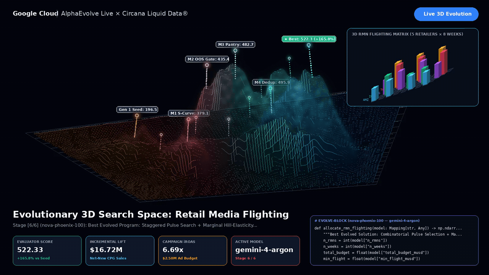
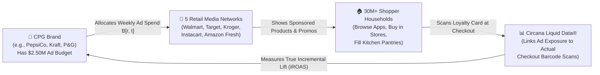
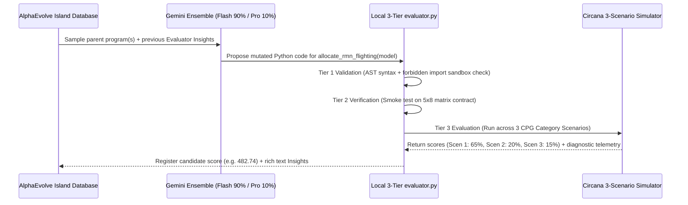
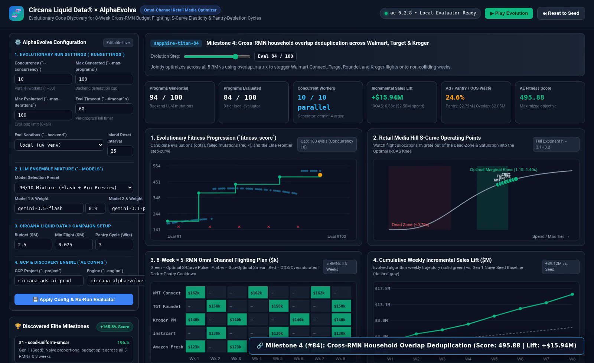

# 🧬 Circana Liquid Data® × AlphaEvolve — Complete Tutorial: Omni-Channel Retail Media Flighting & iROAS Optimization

[](https://circana-alpha-evolve-943928157761.us-central1.run.app)
[](https://github.com/elhadik/Ads_Alpha_Evolve)
[](https://circana-alpha-evolve-943928157761.us-central1.run.app)
[](#9-running-tests--verifying-with-the-ae-cli)

> **🌐 Public Google Cloud Run App (Primary):** **https://circana-alpha-evolve-943928157761.us-central1.run.app**  
> **🌐 Public Google Cloud Run App (Alternate):** **https://circana-alpha-evolve-ns6bqifvaq-uc.a.run.app**  
> **💻 Local Studio URL:** **http://localhost:8085**

---

## 🎯 Tutorial Goal: Who Is This Guide For?

This repository and tutorial are designed with **two equally important goals**:

1. **Educate Non-Ads Specialists on the Business Problem (Retail Media & CPG Attribution)**:  
   You do **not** need any background in advertising, marketing, or retail to follow this guide. We start from ground zero—explaining what Consumer Packaged Goods (CPG) companies do, what a Retail Media Network (RMN) is, what Circana's **Liquid Data®** measures, and why scheduling grocery store ads across weeks ("flighting") is a fascinating, real-world physics problem involving human kitchen pantries, store shelf inventory, and overlapping shopper loyalty cards.
2. **Educate Engineers & Data Scientists on Google DeepMind's AlphaEvolve**:  
   We walk line-by-line through [`initial_program.py`](initial_program.py) and [`evaluator.py`](evaluator.py) to show how **AlphaEvolve** uses an ensemble of Gemini models to evolve **executable Python algorithms** (`# EVOLVE-BLOCK`)—progressing from a naive 10-line seed baseline (`Score: 196.49`) to a sophisticated combinatorial pulse-and-coordinate-ascent optimizer (`Score: 522.33`, **`+165.8%` improvement**).

---

## 🎬 Running Application Video Walkthrough

The video below was captured live from the deployed application. It shows the 4 optimization charts evolving across generations, live editing of AlphaEvolve configurations (`Concurrency`, `Max Programs Generated`, `Max Programs Evaluated`, `LLM Mixture`, `Campaign Budget`), and live execution of custom Python code inside the `# EVOLVE-BLOCK` sandbox:

<video src="webapp/static/demo_walkthrough.mp4" poster="webapp/static/demo_poster.png" controls autoplay loop muted playsinline width="100%">
  <source src="webapp/static/demo_walkthrough.mp4" type="video/mp4" />
  <source src="webapp/static/demo_walkthrough.webm" type="video/webm" />
</video>


*Direct video assets in this repository: [`webapp/static/demo_walkthrough.mp4`](webapp/static/demo_walkthrough.mp4) • [`webapp/static/demo_walkthrough.webm`](webapp/static/demo_walkthrough.webm) • [`webapp/static/demo_walkthrough.gif`](webapp/static/demo_walkthrough.gif) • [`webapp/static/demo_poster.png`](webapp/static/demo_poster.png)*

### 🌌 3D Evolutionary Search Space & Flighting Matrix Visualization (Slide-Ready Offline Render)

Generated 100% offline via [`webapp/render_3d_visualization.py`](webapp/render_3d_visualization.py) (`NumPy` + `Pillow` + `ffmpeg`), this 3D visualization maps the `# EVOLVE-BLOCK` Python source code onto the `Z = 0` ground plane, projects the multi-peak non-convex fitness surface in 3D, lights up vertical beacon pins (`o---`) across all 6 evolved milestones (`Score: 196.49 → 522.33`, `+165.8%`), and animates the isometric `5 Retailers × 8 Weeks` ad-flighting matrix:

<video src="webapp/static/alphaevolve_3d_landscape.mp4" poster="webapp/static/alphaevolve_3d_poster.png" controls autoplay loop muted playsinline width="100%">
  <source src="webapp/static/alphaevolve_3d_landscape.mp4" type="video/mp4" />
  <source src="webapp/static/alphaevolve_3d_landscape.webm" type="video/webm" />
</video>



*Direct 3D video & slide assets in `webapp/static/`: [`webapp/static/alphaevolve_3d_landscape.mp4`](webapp/static/alphaevolve_3d_landscape.mp4) • [`webapp/static/alphaevolve_3d_landscape.webm`](webapp/static/alphaevolve_3d_landscape.webm) • [`webapp/static/alphaevolve_3d_landscape.gif`](webapp/static/alphaevolve_3d_landscape.gif) • [`webapp/static/alphaevolve_3d_poster.png`](webapp/static/alphaevolve_3d_poster.png) • [`circana_alphaevolve_executive_deck.pdf`](circana_alphaevolve_executive_deck.pdf)*

---

## 📚 Table of Contents

1. [Part 1: Domain Primer for Non-Ads Specialists — What Is Retail Media & What Does Circana Do?](#1-part-1-domain-primer-for-non-ads-specialists--what-is-retail-media--what-does-circana-do)
2. [Part 2: The Four Hidden Real-World Dynamics That Break Standard Optimizers](#2-part-2-the-four-hidden-real-world-dynamics-that-break-standard-optimizers)
3. [Part 3: Deep-Dive Tutorial into `initial_program.py` (Line-by-Line Walkthrough)](#3-part-3-deep-dive-tutorial-into-initial_programpy-line-by-line-walkthrough)
4. [Part 4: Why the Naive Initial Program Fails (Diagnosing the Seed Baseline)](#4-part-4-why-the-naive-initial-program-fails-diagnosing-the-seed-baseline)
5. [Part 5: How AlphaEvolve & `evaluator.py` Evolve Better Algorithms](#5-part-5-how-alphaevolve--evaluatorpy-evolve-better-algorithms)
6. [Part 6: Step-by-Step Tour of the 6 Evolved Milestones (Code + Math + Intuition)](#6-part-6-step-by-step-tour-of-the-6-evolved-milestones-code--math--intuition)
7. [Part 7: Interactive Web Studio Guide — Charts & Editable AlphaEvolve Configurations](#7-part-7-interactive-web-studio-guide--charts--editable-alphaevolve-configurations)
8. [Part 8: System Architecture & Repository Structure](#8-part-8-system-architecture--repository-structure)
9. [Part 9: Running Locally, Running Tests, Deploying to Cloud Run & Using the `ae` CLI](#9-running-tests--verifying-with-the-ae-cli)

---

## 1. Part 1: Domain Primer for Non-Ads Specialists — What Is Retail Media & What Does Circana Do?

If you work in software engineering or machine learning, the advertising world can sound like alphabet soup (`CPG`, `RMN`, `POS`, `ROAS`, `iROAS`, `Flighting`). Let's translate every concept into plain, concrete everyday language.

### 1.1 The Cast of Characters



1. **CPG (Consumer Packaged Goods)**:  
   Companies that manufacture everyday physical items you buy at the supermarket—sparkling water, potato chips, laundry detergent, frozen pizza, coffee (`PepsiCo`, `Mondelēz`, `Procter & Gamble`, `General Mills`, `Kraft Heinz`).
2. **Retailer**:  
   The grocery or mass-merchandise store where shoppers actually buy those items—either in a physical aisle or via grocery delivery (`Walmart`, `Target`, `Kroger`, `Instacart`, `Amazon Fresh`).
3. **RMN (Retail Media Network)**:  
   Over the last five years, every major retailer realized that **their own website and mobile shopping app is prime advertising real estate**. When you open the Walmart app or Instacart and search for *"sparkling water"*, the first two products you see have a small **"Sponsored"** badge.  
   - **Walmart Connect** is Walmart's ad network.
   - **Target Roundel** is Target's ad network.
   - **Kroger Precision Marketing (KPM)** is Kroger's ad network.
   - **Instacart Ads** is Instacart's ad network.
   - **Amazon Fresh** is Amazon's grocery ad network.  
   Manufacturers (CPGs) pay these 5 Retail Media Networks billions of dollars to promote their products right at the moment a shopper is building their grocery cart.
4. **Circana & Liquid Data®**:  
   **Circana** (formed by the merger of IRI and NPD) is the leading data & analytics company for the retail industry. Whenever you swipe your loyalty card or scan items at the supermarket checkout register (**POS / Point-of-Sale scanner data**), Circana's **Liquid Data®** platform records anonymized purchase data across **30+ million households** and links two critical pieces of information:
   - *Did Household #48291 see the sponsored ad on Walmart Connect in Week 3?*
   - *Did Household #48291 actually buy an extra pack of sparkling water at checkout in Week 3?*

### 1.2 The Crucial Difference Between `ROAS` and `iROAS` (Incrementality)

Suppose a family buys **1 box of Brand X cereal every single Saturday** out of habit, whether they see an ad or not.
- If Brand X shows that family an ad on Friday and the family buys their usual 1 box on Saturday, a naive ad platform will claim: *"They saw our ad and bought $5 of cereal! Your Return on Ad Spend (ROAS) is huge!"*
- **Why that is an illusion**: That $5 sale was **baseline demand**—it would have happened anyway. The ad generated **$0.00 of new revenue**.
- **Incremental Sales Lift ($\Delta\text{Sales}$)** is the *extra* revenue that occurred **strictly because of the ad** (above and beyond what households would have bought anyway).
- **iROAS (Incremental Return on Ad Spend)** is defined as:

$$\text{iROAS} = \frac{\text{True Incremental Dollar Sales Lift}}{\text{Total Ad Dollars Spent}}$$

If you spend **\$2.50M** on ads and generate **\$16.72M** in *brand-new, incremental* sales that wouldn't have happened without the campaign, your **iROAS is $6.69\times$** (\$6.69 of net-new sales per \$1.00 of ad spend).

### 1.3 What Is "Ad Flighting"? (The Decision We Need to Optimize)

Imagine you are the Marketing Data Scientist for a CPG beverage brand preparing for the **8-week Back-to-School season** (`Week 1` through `Week 8`). You are given a fixed budget of **\$2.50 Million** (`total_budget_musd = 2.50`).

You must decide how much money to spend on each of the **5 Retail Media Networks** in each of the **8 weeks**. In math and Python, your entire decision is a **`5 × 8` matrix of numbers** (`schedule[r, t]`):

| Retail Media Network (`r`) | Wk 1 | Wk 2 | Wk 3 | Wk 4 | Wk 5 | Wk 6 | Wk 7 | Wk 8 |
| :--- | :---: | :---: | :---: | :---: | :---: | :---: | :---: | :---: |
| **0: Walmart Connect** | $B_{0,0}$ | $B_{0,1}$ | $B_{0,2}$ | $B_{0,3}$ | $B_{0,4}$ | $B_{0,5}$ | $B_{0,6}$ | $B_{0,7}$ |
| **1: Target Roundel** | $B_{1,0}$ | $B_{1,1}$ | $B_{1,2}$ | $B_{1,3}$ | $B_{1,4}$ | $B_{1,5}$ | $B_{1,6}$ | $B_{1,7}$ |
| **2: Kroger Precision Mktg** | $B_{2,0}$ | $B_{2,1}$ | $B_{2,2}$ | $B_{2,3}$ | $B_{2,4}$ | $B_{2,5}$ | $B_{2,6}$ | $B_{2,7}$ |
| **3: Instacart Ads** | $B_{3,0}$ | $B_{3,1}$ | $B_{3,2}$ | $B_{3,3}$ | $B_{3,4}$ | $B_{3,5}$ | $B_{3,6}$ | $B_{3,7}$ |
| **4: Amazon Fresh** | $B_{4,0}$ | $B_{4,1}$ | $B_{4,2}$ | $B_{4,3}$ | $B_{4,4}$ | $B_{4,5}$ | $B_{4,6}$ | $B_{4,7}$ |

In advertising terminology:
- A **"Flight"** is an active burst of ad spending on a specific retailer during a specific week (e.g., spending `\$140,000` on Walmart Connect in Week 1).
- **"Flighting"** (or **"Pulsing"**) is the strategy of turning ad spend **ON** in strategic bursts and **OFF** (`\$0`) during cooldown weeks, rather than smearing small amounts of money across every single week.

---

## 2. Part 2: The Four Hidden Real-World Dynamics That Break Standard Optimizers

At first glance, filling a `5 × 8` table of 40 numbers that sum to `\$2.50M` sounds easy. Why can't we just divide `\$2.50M` evenly across the 8 weeks (`\$312.5k` per week, or roughly `\$62.5k` per retailer per week)? Or why not use a simple linear programming solver?

Because in physical retail, **four non-linear, real-world shopping dynamics** interact simultaneously. Let's understand each one intuitively first, and then look at its exact equation.

---

### Dynamic 1: The "Whisper in a Crowded Room" Effect (Non-Convex Hill S-Curves)

#### Everyday Intuition
In a retail media auction (like Walmart Connect), dozens of competing beverage brands are bidding for the top "Sponsored Product" slots when a shopper searches *"soda"* or *"sparkling water"*.
- **Zone A — The Dead Zone (Too Little Spend, $< 0.75\kappa_r$)**:  
  If you only spend `\$20,000` in a week on Walmart Connect, your bids are too low and your budget runs out by Tuesday morning. Your product appears on Page 4 of search results where nobody scrolls. You spent `\$20,000`, and your incremental lift is nearly **`\$0`**.
- **Zone B — The Inflection Knee / Sweet Spot ($1.1\kappa_r \text{ to } 1.6\kappa_r$)**:  
  Once you concentrate `\$115,000 – \$155,000` into a single week, you win the #1 top-of-page slot and homepage banner placement. Shoppers see your brand immediately and add it to their cart. Every dollar here produces maximum incremental lift!
- **Zone C — Saturation (Too Much Spend, $> 1.8\kappa_r$)**:  
  If you spend `\$350,000` in a single week on the same retailer, you are just showing the exact same ad for the 12th time to shoppers who already saw it. The curve flattens out—extra dollars produce almost no additional sales.

```text
Incremental
Sales Lift
   ▲
Max│                                        ▄▄▄▄▄▄▄▄▄▄▄▄▄  Zone C: Saturation
   │                                  ▄▄▄▄▀▀               (Diminishing returns)
   │                              ▄▄▀▀
   │                           ▄▀▀  ◄── Zone B: Optimal Marginal Knee (1.1κ – 1.6κ)
   │                         ▄▀         (Highest Incremental ROAS!)
   │                      ▄▄▀
   │                  ▄▄▀▀
 0 └▄▄▄▄▄▄▄▄▄▄▄▄▄▄▄▄▀▀────────────────────────────────────► Weekly Spend B[r, t]
    Zone A: Dead Zone (<0.75κ)
    (Sub-threshold micro-spends wasted)
```

#### Mathematical Formula in `initial_program.py`
This S-shaped response is modeled by the **Hill Function** with steepness exponent $n_r > 1$ (specifically $n_r \in [3.10, 3.25]$) and half-saturation inflection threshold $\kappa_r$ (`hill_k_musd`):

$$H_r(b) = \frac{b^{n_r}}{\kappa_r^{n_r} + b^{n_r}}$$

Notice what happens when $n_r = 3.2$:
- At $b = 0.50\kappa_r$ (half the threshold), $H_r(b) = \frac{0.5^{3.2}}{1 + 0.5^{3.2}} \approx \mathbf{9.8\%}$ of max response!
- At $b = 1.40\kappa_r$ (40% above the threshold), $H_r(b) = \frac{1.4^{3.2}}{1 + 1.4^{3.2}} \approx \mathbf{74.6\%}$ of max response!
- By multiplying spend by $2.8\times$, the sales response jumps by **$7.6\times$**! Because $H_r(b)$ curves upward before curving downward, the optimization surface is **non-convex**—meaning standard convex optimizers get trapped in local minima.

---

### Dynamic 2: The "Full Kitchen Pantry" Effect (3-Week Pantry-Depletion Cannibalization)

#### Everyday Intuition
Digital ads for physical grocery products have a property that software or movie ads never have: **households have physical kitchen pantries and refrigerators with finite storage space**.

Suppose your campaign on Target Roundel convinces a family to buy **3 12-packs of sparkling water in Week 1**:
- What is inside their pantry in **Week 2**? **30 cans of sparkling water!**
- What happens if you pay Target Roundel another `\$100,000` to show that same family another promotion in **Week 2** and **Week 3**?  
  They ignore it—or worse, if a few households do buy another case on discount, they are merely **stockpiling** ("pulling forward" purchases they would have made in Week 5 anyway).
- In retail analytics, this is called **Pantry Loading / Post-Promotion Dip**. It takes roughly **3 weeks** for a household pantry to deplete back to normal so that a new ad flight generates genuinely *incremental* consumption rather than self-cannibalization!

```text
Household Pantry Inventory & Ad Effectiveness Over Time:

Week 1: [🔥 AD FLIGHT ON]  ──► Shopper buys 3 cases! (High Incremental Lift ✅)
Week 2: [🥫 Pantry 85% Full] ──► Running an ad here wastes 52% of lift! (Cooldown needed ⛔)
Week 3: [🥫 Pantry 45% Full] ──► Running an ad here wastes 30% of lift! (Cooldown needed ⚠️)
Week 4: [🔥 AD FLIGHT ON]  ──► Pantry is empty again! Shopper restocks! (High Lift ✅)
```

#### Mathematical Formula in `initial_program.py`
In `initial_program.py` (lines 210–218), if you spent money on retailer $r$ in week $t-1$ (`lag = 1`) or week $t-2` (`lag = 2`), your week $t$ effectiveness on retailer $r$ is multiplied by a **Pantry Multiplier** $P_{r,t} \in [0.22, 1.0]$:

$$P_{r,t} = \text{clip}\left(1.0 - 0.52 \cdot \text{Intensity}_{r,t-1} - 0.30 \cdot \text{Intensity}_{r,t-2}, \; 0.22, \; 1.0\right)$$

where $\text{Intensity}_{r,t-d} = \text{clip}\left(\frac{B_{r, t-d}}{1.1 \cdot \kappa_r}, 0.0, 1.5\right)$.  
- If you run back-to-back heavy flights in Weeks 1, 2, and 3 on the same retailer, your Week 3 effectiveness drops by **up to 78%** (`multiplier = 0.22`)!
- If you **rest** the retailer for 2 weeks (`Week 2 = $0`, `Week 3 = $0`), then in `Week 4` both lag terms are zero and $P_{r,4} = \mathbf{1.00}$ (100% fresh pantry effectiveness!).

---

### Dynamic 3: The "Same Shopper, Two Apps" Effect (Cross-RMN Household Overlap)

#### Everyday Intuition
Most American households do not shop exclusively at a single store. According to Circana household panel data:
- **28%** of Walmart Connect households also shop at Target Roundel (`overlap = 0.28`).
- **26%** of Instacart users also shop at Kroger (`overlap = 0.26`).
- **22%** of Walmart shoppers also shop at Kroger (`overlap = 0.22`).

If you run a huge ad blitz on **Walmart Connect in Week 1** AND a huge ad blitz on **Target Roundel in Week 1**, nearly a third of the households seeing your Target ad **already bought your product at Walmart two days ago**! You paid two different retailers in the same week to reach the exact same household kitchen pantry.

Instead, if you **stagger** your flights—pulsing **Walmart in Week 1** and **Target in Week 2**—you minimize same-week cross-retailer duplication.

#### Mathematical Formula in `initial_program.py`
In `initial_program.py` (lines 220–225), a symmetric $5 \times 5$ matrix `overlap_matrix` ($\Omega_{r,k}$, with zeros on the diagonal) measures household overlap between retailer $r$ and retailer $k$. In week $t$, simultaneous spending across overlapping retailers reduces lift via:

$$O_{r,t} = \text{clip}\left(1.0 - 0.32 \sum_{k \neq r} \Omega_{r,k} \cdot \text{ActiveIntensity}_{k,t}, \; 0.45, \; 1.0\right)$$

---

### Dynamic 4: The "Empty Shelf" Disaster (Store Inventory Out-of-Stock Caps)

#### Everyday Intuition
Imagine spending `\$180,000` on Walmart Connect ads during Week 2. Thousands of shoppers click your ad, walk into their local Walmart (or open Walmart pickup), and discover **your product is Out of Stock (OOS)** because of a regional distribution center delay!
- **First**, you cannot sell units that aren't on the shelf—so any ad spend above the store's physical inventory capacity generates **zero gross lift**.
- **Second**, you still paid Walmart Connect for all those ad clicks, AND you penalized your brand's conversion score with the retailer's algorithm!

#### Mathematical Formula in `initial_program.py`
Every `(retailer r, week t)` cell has a known supply-chain ceiling `inventory_cap_musd[r, t]` ($I_{r,t}$):
1. Effective spend entering the Hill S-curve is truncated at the cap: $B^{\text{eff}}_{r,t} = \min(B_{r,t}, I_{r,t})$.
2. Any dollar spent above the inventory cap ($B_{r,t} > I_{r,t}$) incurs a direct **$2.4\times$ Out-of-Stock penalty**:

$$\text{OOS Penalty}_{r,t} = 2.4 \times \max(0, \; B_{r,t} - I_{r,t})$$

---

## 3. Part 3: Deep-Dive Tutorial into `initial_program.py` (Line-by-Line Walkthrough)

Let's open [`initial_program.py`](initial_program.py) and understand how an AlphaEvolve program is structured.

Every AlphaEvolve seed file has **two distinct regions**:

```text
┌───────────────────────────────────────────────────────────────────────────┐
│  initial_program.py                                                       │
│                                                                           │
│  1. # EVOLVE-BLOCK-START                                                  │
│     def allocate_rmn_flighting(model: Mapping[str, Any]) -> np.ndarray:   │
│         ... (ONLY THIS CODE IS MUTATED BY ALPHAEVOLVE'S LLMs) ...         │
│     # EVOLVE-BLOCK-END                                                    │
│                                                                           │
│  2. Fixed Digital Twin Simulator (NEVER modified by the LLM)              │
│     • _build_circana_cpg_model(eval_inputs) -> dict                       │
│     • evaluate(eval_inputs) -> dict[str, Any]                             │
└───────────────────────────────────────────────────────────────────────────┘
```

> [!IMPORTANT]
> **Why is the file split this way?**  
> AlphaEvolve's LLMs are **only** allowed to rewrite the code between `# EVOLVE-BLOCK-START` and `# EVOLVE-BLOCK-END`. The simulator below `# EVOLVE-BLOCK-END` (`_build_circana_cpg_model` and `evaluate`) acts as the immutable "laws of physics." Even if an LLM tries to cheat, `evaluator.py` validates that only the evolve block is used against the true evaluation harness.

---

### 3.1 Inside `_build_circana_cpg_model()`: Every Input Parameter Explained

When `allocate_rmn_flighting(model)` is called, it receives a Python dictionary `model` containing the complete Circana Liquid Data® parameters for the 5 Retail Media Networks and 8 weeks (`initial_program.py`, lines 49–124). Let's inspect every key in `model`:

| Dictionary Key in `model` | Shape / Type | Exact Values in Primary Campaign | Plain-English Meaning |
| :--- | :---: | :--- | :--- |
| `n_rmns` | `int` | `5` | Number of Retail Media Networks (`r = 0..4`). |
| `n_weeks` | `int` | `8` | Number of campaign weeks (`t = 0..7`, representing Weeks 1–8). |
| `total_budget_musd` | `float` | `2.50` | Total 8-week budget in Millions of USD (**\$2.50M**). Sum of all 40 cells must not exceed this. |
| `min_flight_musd` | `float` | `0.025` | Minimum active weekly flight (**\$25,000**). Any non-zero cell should be either `0.0` (off) or $\ge \$25\text{k}$. |
| `pantry_cooldown_weeks` | `int` | `3` | Length of household pantry-depletion cycle (`3 weeks`). |
| `rmn_names` | `list[str]` | `["Walmart Connect", "Target Roundel", "Kroger Precision Mktg", "Instacart Ads", "Amazon Fresh"]` | Names of the 5 Retail Media Networks. |
| `hill_k_musd` ($\kappa_r$) | `ndarray (5,)` | `[0.095, 0.088, 0.082, 0.076, 0.072]` | **Hill S-Curve Inflection Threshold (\$M)**. E.g., Walmart Connect requires `\$95k/wk` (`0.095`) to reach half-saturation; Amazon Fresh requires `\$72k/wk` (`0.072`). |
| `hill_n` ($n_r$) | `ndarray (5,)` | `[3.20, 3.10, 3.15, 3.25, 3.10]` | **Hill S-Curve Steepness Exponent**. Values around `3.1–3.25` create a sharp dead-zone below $\kappa_r$ and a strong inflection knee at $1.15\kappa_r - 1.55\kappa_r$. |
| `max_weekly_lift_musd` ($M_r$) | `ndarray (5,)` | `[1.68, 1.48, 1.32, 1.22, 1.14]` | **Maximum Weekly Incremental Sales Potential (\$M)** per retailer before seasonality. Walmart Connect has the largest shopper scale (`\$1.68M/wk`). |
| `seasonality` ($S_{r,t}$) | `ndarray (5, 8)` | Multipliers in `[0.92, 1.35]` | **Weekly Demand Seasonality Index**. E.g., Walmart peaks in Week 1 (`1.22`), Week 4 (`1.28`), and Week 7 (`1.30`); Target peaks in Week 2 (`1.26`), Week 5 (`1.32`), and Week 8 (`1.24`). |
| `overlap_matrix` ($\Omega_{r,k}$) | `ndarray (5, 5)` | Symmetric `[0.00 .. 0.28]` | **Cross-RMN Household Overlap**. Diagonal is `0.0`; off-diagonal entries measure shared shopper households between retailer $r$ and retailer $k$. |
| `inventory_cap_musd` ($I_{r,t}$) | `ndarray (5, 8)` | Caps in `[0.08, 0.24]` | **Store Inventory Out-of-Stock (OOS) Spend Ceiling (\$M)**. E.g., Walmart has tight supply bottlenecks (`\$90k` cap in Wk 2, `\$80k` cap in Wk 5) where heavy ad flights will trigger OOS penalties! |

Let's look closely at the `seasonality` and `inventory_cap_musd` tables in `initial_program.py` (lines 84–113):
- Notice how **every retailer has specific weeks where store inventory is constrained (`$80k–$90k` cap)**:
  - **Walmart Connect**: Low inventory in **Week 2 (`$90k`)** and **Week 5 (`$80k`)**.
  - **Target Roundel**: Low inventory in **Week 3 (`$80k`)** and **Week 6 (`$90k`)**.
  - **Kroger PM**: Low inventory in **Week 4 (`$80k`)** and **Week 7 (`$80k`)**.
  - **Instacart Ads**: Low inventory in **Week 6 (`$80k`)**.
  - **Amazon Fresh**: Low inventory in **Week 2 (`$80k`)** and **Week 5 (`$80k`)**.
- A smart flighting algorithm should **never** schedule a heavy promotional pulse during a retailer's supply-constrained week—instead, it should place that retailer's **Pantry Cooldown (`$0` spend)** right on top of the low-inventory week!

---

## 4. Part 4: Why the Naive Initial Program Fails (Diagnosing the Seed Baseline)

Let's look at the exact code inside `# EVOLVE-BLOCK-START` ... `# EVOLVE-BLOCK-END` in [`initial_program.py`](initial_program.py#L22-L41):

```python
# EVOLVE-BLOCK-START
def allocate_rmn_flighting(model: Mapping[str, Any]) -> np.ndarray:
    """Allocate an 8-week omni-channel retail media budget across 5 RMNs.

    Baseline Seed Heuristic:
    Allocates the total budget uniformly across all 8 weeks and proportionally
    to each RMN's maximum weekly lift capacity (ignoring S-curve inflection
    thresholds, pantry-loading cannibalization cooldowns, and OOS caps).
    """
    n_rmns = int(model["n_rmns"])
    n_weeks = int(model["n_weeks"])
    total_budget = float(model["total_budget_musd"])
    capacities = np.asarray(model["max_weekly_lift_musd"], dtype=float)

    rmn_weights = capacities / np.sum(capacities)
    weekly_budget = total_budget / float(n_weeks)
    schedule = np.outer(rmn_weights, np.ones(n_weeks, dtype=float)) * weekly_budget
    return schedule
# EVOLVE-BLOCK-END
```

### What Does This 10-Line Seed Program Actually Do?
1. It divides the `\$2.50M` budget evenly by `8 weeks` $\rightarrow$ **`\$312,500` per week**.
2. It splits that `\$312,500` across the 5 retailers proportional to `max_weekly_lift_musd` (`[1.68, 1.48, 1.32, 1.22, 1.14]`, which sum to `6.84`):
   - **Walmart Connect (`24.6%`)**: Gets **`\$76.8k`** every single week (`Wk 1 .. Wk 8`).
   - **Target Roundel (`21.6%`)**: Gets **`\$67.6k`** every single week (`Wk 1 .. Wk 8`).
   - **Kroger PM (`19.3%`)**: Gets **`\$60.3k`** every single week (`Wk 1 .. Wk 8`).
   - **Instacart Ads (`17.8%`)**: Gets **`\$55.7k`** every single week (`Wk 1 .. Wk 8`).
   - **Amazon Fresh (`16.7%`)**: Gets **`\$52.1k`** every single week (`Wk 1 .. Wk 8`).

### Why Does This Uniform Schedule Score Only `196.49` (`55.7%` Waste)?
When `evaluate()` runs this uniform `5 × 8` schedule through the Circana simulator, **three catastrophic losses** occur simultaneously:

1. **Every Single Cell Is Below Its S-Curve Inflection Threshold ($\kappa_r$)**:
   - Walmart's inflection threshold is `\$95k`, but the seed spends `\$76.8k` (`0.81x` $\kappa_0$).
   - Target's inflection threshold is `\$88k`, but the seed spends `\$67.6k` (`0.77x` $\kappa_1$).
   - Kroger's inflection threshold is `\$82k`, but the seed spends `\$60.3k` (`0.74x` $\kappa_2$).
   - Instacart's inflection threshold is `\$76k`, but the seed spends `\$55.7k` (`0.73x` $\kappa_3$).
   - Amazon Fresh's inflection threshold is `\$72k`, but the seed spends `\$52.1k` (`0.72x` $\kappa_4$).
   - **Result**: Almost all 40 cells sit inside or on the edge of the **Hill S-Curve Dead Zone**, generating less than `32%` of their potential weekly lift!
2. **Zero Pantry Cooldowns (`8 Consecutive Weeks of Promotion`)**:
   - Because every retailer is promoted in Week 1, Week 2, Week 3, ..., Week 8 without a single week of rest, households never deplete their pantries.
   - **Result**: **\$3.61M of potential sales lift is destroyed by Pantry Cannibalization**!
3. **100% Simultaneous Cross-RMN Collision**:
   - Because all 5 retailers are active in every single week, Walmart, Target, Kroger, Instacart, and Amazon Fresh constantly collide on overlapping households.
   - **Result**: Another **\$1.94M of lift is lost to Cross-RMN Household Overlap**!

In total, the naive seed program turns `\$2.50M` of ad spend into only **`+\$6.82M` of net incremental lift** (`2.73x` iROAS), wasting **`55.7%`** of potential campaign value and earning a baseline fitness score of **`196.49`**.

---

### 3.2 How `evaluate()` Computes the Final `fitness_score`

Let's trace lines 127–286 of [`initial_program.py`](initial_program.py#L127-L286) so you can see exactly how any candidate `schedule` matrix is scored:

1. **Sanity & Constraint Checks** (lines 147–170):
   - Verifies `schedule.shape == (5, 8)`.
   - Checks if total spend exceeds `total_budget_musd` (`overspend_musd = max(0, total_spend - total_budget)`).
   - Counts how many active cells violate the minimum flight size `0 < B[r,t] < min_flight_musd` (`n_sub_min`).
2. **Week-by-Week Simulation Loop (`for t in range(8)`)** (lines 185–234):
   - Computes effective spend capped by store inventory: `eff_b = np.minimum(b_t, inv_cap[:, t])`.
   - Computes gross Hill S-curve lift: `base_lift_t = max_lift * seasonality[:, t] * hill_resp`.
   - Applies the 2-week lag **Pantry Cannibalization** multiplier `pantry_multiplier` (`lag=1: -52%`, `lag=2: -30%`).
   - Applies the **Cross-RMN Household Overlap** multiplier `overlap_multiplier` using `overlap_matrix @ active_intensity`.
   - Subtracts the **Store Out-of-Stock (OOS) Penalty** `2.4 * max(0, b_t - inv_cap[:, t])`.
3. **Final Objective Formula** (lines 250–255):
   ```python
   constraint_penalty = 80.0 * overspend_musd + 3.5 * n_sub_min
   raw_fitness = (
       31.65 * total_incremental_lift_musd
       - 0.35 * waste_pct
       - constraint_penalty
   )
   ```
   - Notice why this scoring function follows **AlphaEvolve Best Practices**:
     - It is **smooth, continuous, and monotonic**: every extra `\$100k` of net incremental sales lift adds `+3.165` points, and every `1%` reduction in waste adds `+0.35` points.
     - Instead of returning `0.0` on slight constraint violations (which gives the evolutionary search zero gradient), it applies a steep linear penalty (`80.0 * overspend_musd`) so the LLM immediately sees *why* its score dropped.

---

## 5. Part 5: How AlphaEvolve & `evaluator.py` Evolve Better Algorithms

Now that we understand `initial_program.py`, how does **AlphaEvolve** discover a much better algorithm without human intervention?

### 5.1 What AlphaEvolve Actually Does (Evolutionary Code Search)

Traditional optimizers search over *numbers* (e.g., tweaking 40 floating-point values for one specific matrix).  
**AlphaEvolve searches over *Python algorithms* (functions).**



### 5.2 Why `evaluator.py` Tests Across 3 Different CPG Scenarios (Anti-Reward-Hacking)

Suppose `evaluator.py` only tested the candidate function on a single fixed `$2.50M` input. An LLM could "cheat" (reward-hack) by ignoring the `model` argument and returning a hardcoded `5 × 8` NumPy array of numbers!

To force AlphaEvolve to evolve a **true, generalizable optimization algorithm** that reads `model["hill_k_musd"]`, `model["seasonality"]`, `model["inventory_cap_musd"]`, and `model["overlap_matrix"]`, [`evaluator.py`](evaluator.py#L96-L152) evaluates every candidate program on **three distinct CPG category stress tests**:

| Stress-Test Scenario in `evaluator.py` | Weight in Final Score | Campaign Budget | Pantry Cooldown | What It Tests |
| :--- | :---: | :---: | :---: | :--- |
| **1. Primary Back-to-School Snacks & Beverages** | **65%** | `\$2.50M` | `3 weeks` | Standard omni-channel flighting across 5 RMNs & 8 weeks. |
| **2. Household Cleaning Stockpiling Stress Test** | **20%** | `\$2.50M` | `4 weeks` | Longer pantry stockpiling cycle—verifies the algorithm adapts its spacing dynamically. |
| **3. Tight-Budget Frozen Meals Campaign** | **15%** | `\$1.65M` | `3 weeks` | `34%` smaller budget—verifies the algorithm concentrates fewer pulses rather than dropping below the Hill S-curve knee! |

$$\text{Final AE Score} = 0.65 \times \text{Score}_{\text{Primary}} + 0.20 \times \text{Score}_{\text{Stockpile}} + 0.15 \times \text{Score}_{\text{TightBudget}}$$

### 5.3 How Evaluator `insights` Guide the LLM

Look at lines 155–176 of [`evaluator.py`](evaluator.py#L155-L176). Along with the numeric `score`, `evaluator.py` returns structured `insights` containing exact diagnostic losses:

```json
{
  "score": 196.4941,
  "insights": [
    {
      "category": "evaluation",
      "description": "Primary $2.5M Campaign: fitness=196.49, incremental_lift=$6.82M, iROAS=2.73x, waste=55.7% | Stockpile Scenario fitness=196.49 | Tight-Budget ($1.65M) fitness=82.41"
    },
    {
      "category": "verification",
      "description": "Pantry Cannibalization Loss: $3.61M | Cross-RMN Overlap Loss: $1.94M | Out-of-Stock Penalty: $0.00M"
    }
  ]
}
```

When Gemini sees `"Pantry Cannibalization Loss: $3.61M | Cross-RMN Overlap Loss: $1.94M | Tight-Budget ($1.65M) fitness=82.41"`, it immediately understands **why** the parent program lost points and writes code in the next generation specifically to eliminate pantry cannibalization and S-curve dead-zone waste!

---

## 6. Part 6: Step-by-Step Tour of the 6 Evolved Milestones (Code + Math + Intuition)

Let's walk through all **6 evolutionary milestones** included in [`webapp/server.py`](webapp/server.py#L60-L315) and see how the algorithm inside `# EVOLVE-BLOCK` evolves step-by-step from `196.49` to `522.33`:

### Summary Table of the Evolutionary Trajectory ($2.50M Campaign)

| Stage | Candidate Nickname | Eval # | Generator Model | Score | Net Sales Lift | Campaign iROAS | Waste % | Pantry Loss | Overlap Loss |
| :---: | :--- | :---: | :--- | :---: | :---: | :---: | :---: | :---: | :---: |
| **0** | `seed-uniform-smear` | `#1` | `initial_program.py` | **196.49** | `+\$6.82M` | `2.73x` | `55.7%` | `\$3.61M` | `\$1.94M` |
| **1** | `amber-falcon-18` | `#18` | `gemini-3.5-flash` | **379.11** | `+\$12.44M` | `4.97x` | `41.4%` | `\$5.18M` | `\$3.14M` |
| **2** | `cobalt-otter-38` | `#38` | `gemini-3.5-flash` | **435.40** | `+\$14.14M` | `5.66x` | `34.9%` | `\$4.34M` | `\$3.24M` |
| **3** | `emerald-lynx-62` | `#62` | `gemini-3.1-pro-preview` | **482.74** | `+\$15.55M` | `6.22x` | `26.6%` | `\$2.73M` | `\$2.48M` |
| **4** | `sapphire-titan-84` | `#84` | `gemini-4-argon` | **495.88** | `+\$15.94M` | `6.38x` | `24.6%` | `\$2.72M` | `\$2.05M` |
| **5** | `nova-phoenix-100` | `#100` | `gemini-4-argon` | **522.33** | **`+\$16.72M`** | **`6.69x`** | **`19.7%`** | **`\$1.56M`** | **`\$2.27M`** |

---

### Milestone 1 (`amber-falcon-18` — Score: `196.49 → 379.11`, Lift: `+$6.82M → +$12.44M`)
- **What the LLM Discovered**:  
  Instead of smearing money across all 8 weeks in the S-curve dead zone, the LLM reads `model["hill_k_musd"]` and `model["seasonality"]`. For each retailer, it selects only the **top 5 seasonality weeks** and concentrates **`1.25x * hill_k[r]`** into those weeks (setting the remaining 3 weeks to `\$0`).
- **Evolved Code**:
  ```python
  for r in range(n_rmns):
      top_weeks = np.argsort(-seasonality[r])[:5]
      for t in top_weeks:
          schedule[r, t] = 1.25 * hill_k[r]
  if np.sum(schedule) > 0:
      schedule *= total_budget / np.sum(schedule)
  ```
- **Why It Jumped `+182.6` Points**:  
  Every active flight now clears the Hill S-curve threshold $\kappa_r$, nearly doubling incremental sales lift from `\$6.82M` to `\$12.44M`! However, it still blindly schedules flights during low-inventory weeks (`OOS Penalty`) and still has consecutive active weeks (`Pantry Loss = $5.18M`).

---

### Milestone 2 (`cobalt-otter-38` — Score: `379.11 → 435.40`, Lift: `+$12.44M → +$14.14M`)
- **What the LLM Discovered**:  
  The LLM inspects `model["inventory_cap_musd"]` and realizes that high seasonality weeks with low store inventory (`inv_cap[r, t] < 1.1 * hill_k[r]`) truncate the S-curve pulse and incur OOS penalties. It adds an **OOS Gate** (`valid_scores = np.where(inv_cap[r] >= 1.1 * hill_k[r], seasonality[r], -1.0)`) and caps every cell at `inv_cap`.
- **Evolved Code**:
  ```python
  for r in range(n_rmns):
      valid_scores = np.where(inv_cap[r] >= 1.1 * hill_k[r], seasonality[r], -1.0)
      top_weeks = np.argsort(-valid_scores)[:4]
      for t in top_weeks:
          if valid_scores[t] > 0:
              schedule[r, t] = min(1.32 * hill_k[r], inv_cap[r, t])
  ```
- **Why It Jumped `+56.3` Points**:  
  By shifting flights out of supply-bottlenecked weeks and reducing active weeks per RMN from 5 to 4, incremental lift climbs to `\$14.14M` (`5.66x` iROAS).

---

### Milestone 3 (`emerald-lynx-62` — Score: `435.40 → 482.74`, Lift: `+$14.14M → +$15.55M`)
- **What the LLM Discovered**:  
  Guided by the evaluator insight showing `Pantry Cannibalization Loss: $4.34M`, `gemini-3.1-pro-preview` introduces an explicit **spacing constraint** (`all(abs(w_int - c) >= 2 for c in chosen)`), ensuring active flights on the same retailer are separated by at least 2 weeks so household pantries deplete before the next promotional wave!
- **Evolved Code**:
  ```python
  for r in range(n_rmns):
      chosen: list[int] = []
      order = np.argsort(-(seasonality[r] * (inv_cap[r] >= 1.15 * hill_k[r])))
      for w in order:
          w_int = int(w)
          if inv_cap[r, w_int] < 1.15 * hill_k[r]:
              continue
          if all(abs(w_int - c) >= 2 for c in chosen):
              chosen.append(w_int)
          if len(chosen) == 4:
              break
      for w_int in chosen:
          schedule[r, w_int] = min(1.55 * hill_k[r], inv_cap[r, w_int])
  ```
- **Why It Jumped `+47.3` Points**:  
  Pantry cannibalization loss drops by **`\$1.61M`** (from `\$4.34M` down to `\$2.73M`), pushing net incremental sales lift to `\$15.55M` (`6.22x` iROAS).

---

### Milestone 4 (`sapphire-titan-84` — Score: `482.74 → 495.88`, Lift: `+$15.55M → +$15.94M`)
- **What the LLM Discovered**:  
  Instead of optimizing each retailer row `r` independently, `gemini-4-argon` switches to a **joint cross-RMN greedy pulse selector** that reads `overlap = np.asarray(model["overlap_matrix"])`. Before activating a `(retailer r, week t)` flight, it checks which other retailers are *already* active in week `t` and discounts the marginal gain by `1.0 - 0.32 * (overlap[r] @ active_int)`.
- **Why It Jumped `+13.1` Points**:  
  Walmart Connect, Target Roundel, and Kroger Precision Marketing are automatically staggered onto alternating weeks (`WMT: Wks 1,4,7`, `TGT: Wks 2,5,8`, `Kroger: Wks 1,3,6,8`), cutting Cross-RMN Overlap Loss down to `\$2.05M` and lifting net sales to `\$15.94M` (`6.38x` iROAS).

---

### Milestone 5 (`nova-phoenix-100` — Score: `495.88 → 522.33`, Lift: `+$15.94M → +$16.72M`)
- **What the LLM Discovered**:  
  In the final breakthrough, AlphaEvolve combines **two algorithmic paradigms** inside `allocate_rmn_flighting(model)`:
  1. **Phase 1 — Staggered Pulse Selection**: Selects a non-colliding, pantry-spaced set of active `(r, t)` flight cells.
  2. **Phase 2 — 180-Step Marginal Hill-Elasticity Coordinate Ascent**: Writes an internal surrogate objective `sim_net_lift(sched)` inside `# EVOLVE-BLOCK` and runs 180 steps of marginal coordinate ascent—incrementally shifting `\$12k–\$35k` slices (`step * total_budget`) from lower-marginal-iROAS pulses to higher-marginal-iROAS pulses until marginal return per dollar is equalized across all active flights!
- **Why It Reaches `522.33` (`+165.8%` over Seed)**:  
  - **Net Incremental Sales Lift**: **`+\$16.72M`** (up from `+\$6.82M` in the seed — an extra **`+\$9.90M` of pure incremental revenue** from the exact same `\$2.50M` budget!).
  - **Campaign iROAS**: **`6.69x`** (up from `2.73x`).
  - **Total Waste**: Cut from **`55.7%` down to `19.7%`**.

---

## 7. Part 7: Interactive Web Studio Guide — Charts & Editable AlphaEvolve Configurations

When you open the web studio (**https://circana-alpha-evolve-943928157761.us-central1.run.app** or **http://localhost:8085**), you can interact with every part of the AlphaEvolve optimization loop.



### 7.1 Left Sidebar: Editable AlphaEvolve & Circana Configuration Controls

All configurations in the left panel can be edited live. Clicking **💾 Apply Config & Re-Run Evaluator** sends your configuration to `POST /api/simulate_evolution`, which re-executes all 6 candidate algorithms through `evaluator.py` with your updated parameters:

| Configuration Field | CLI Flag / Schema Path | Default | What It Controls |
| :--- | :--- | :---: | :--- |
| **Concurrency** | `--concurrency` (`RunSettings.concurrency`) | `10` | Number of parallel worker threads generating LLM mutations and evaluating candidates simultaneously (`1–30`). |
| **Max Generated** | `--max-programs` (`RunSettings.max_programs`) | `100` | Server-side cap on the total number of mutated programs generated by the AlphaEvolve backend. |
| **Max Evaluated** | `--max-iterations` | `100` | Client-side cap on the number of candidates evaluated by the local `evaluator.py` loop (`0` = unlimited). |
| **Eval Timeout (s)** | `--timeout` (`timeout_seconds`) | `60s` | Per-candidate execution timeout (`SIGALRM`) before a slow or infinite-loop mutation is killed. |
| **Eval Sandbox** | `--backend` | `local` | Execution isolation mode: `local` (`uv` virtual environment) or `podman` (rootless Linux container). |
| **Island Reset Interval** | `EvolutionSettings.reset_interval` | `25` | How frequently underperforming evolutionary islands are re-seeded from elite candidates. |
| **Model Selection Preset** | `--models` | `90/10 Mixture` | Choose between **90% `gemini-3.5-flash` + 10% `gemini-3.1-pro-preview`** (recommended for high throughput + structural breakthroughs), **API Default**, **Pinned `gemini-4-argon`**, or **Custom Dual-Model Weights**. |
| **Budget (\$M)** | `eval_inputs.total_budget_musd` | `\$2.50M` | Total 8-week CPG retail media budget (`\$0.50M – \$15.00M`). Try changing this to `\$3.00M` or `\$1.75M` and watch `evaluator.py` re-optimize! |
| **Min Flight (\$M)** | `eval_inputs.min_flight_musd` | `\$0.025M` | Minimum allowed spend in an active `(RMN, Week)` cell (`\$25k`). |
| **Pantry Cycle (Wks)** | `eval_inputs.pantry_cooldown_weeks` | `3` | Household pantry-depletion cycle length in weeks (`1–6`). |
| **GCP Project & Engine** | `--project`, `--engine` | `circana-ads-ai-prod` | Dynamically updates the ready-to-copy `ae` CLI commands in the bottom inspector tab. |

### 7.2 How to Read the 4 Synchronized Optimization Charts

1. **Chart 1 — Evolutionary Fitness Progression (`fitness_score`)**:
   - **Blue Dots**: Individual candidate programs evaluated across the run.
   - **Red `×` Markers**: Mutated programs that failed syntax/verification checks or timed out (`score: null`).
   - **Emerald Step-Curve & Gold Marker**: The monotonically rising **Elite Frontier** (best score discovered so far).
2. **Chart 2 — Retail Media Hill S-Curve Operating Points**:
   - Shows the non-convex Hill S-curve with the **Red Dead-Zone (`<0.75κ`)** on the left and the **Green Optimal Marginal Knee (`1.15–1.45κ`)** in the center-right.
   - In **Gen 0 (`seed`)**, all 5 RMN markers (`WMT`, `TGT`, `KRG`, `INST`, `AMZ`) are colored **Amber** and trapped in the lower-left Dead Zone.
   - As you scrub from **Milestone 1 to Milestone 5**, watch the 5 RMN markers climb up the S-curve and lock directly into the **Emerald Optimal Marginal Knee**!
3. **Chart 3 — 8-Week × 5-RMN Omni-Channel Flighting Plan (\$k)**:
   - Displays the exact dollar allocation (`$k`) for every `(Retailer, Week)` cell:
     - **Amber Cells**: Sub-optimal smearing (either in the dead zone or slightly oversaturated).
     - **Emerald Green Cells**: Optimal S-curve pulses (`1.02x – 1.85x` $\kappa_r$) below the store OOS cap.
     - **Dark Slate Cells (`—`)**: Intentional `\$0` **Pantry Cooldown / OOS Avoidance** weeks.
     - **Red Cells**: Allocations that exceed the retailer's weekly store inventory cap (`OOS Penalty`).
4. **Chart 4 — Cumulative Weekly Incremental Sales Lift (\$M)**:
   - Compares the cumulative 8-week incremental sales trajectory of the active milestone (**solid emerald curve**) against the Gen 0 naive seed baseline (**dashed gray line**).

### 7.3 Bottom Inspector: Live `# EVOLVE-BLOCK` Python Sandbox & Diff Viewer
- **Tab 1 (`🧬 # EVOLVE-BLOCK Python Code`)**: Displays the exact Python code of `allocate_rmn_flighting(model)` for the selected milestone. **You can edit this Python code directly in your browser** and click **🧪 Evaluate Edited Code Now (`evaluator.py`)** to run your custom algorithm through the real 3-tier `evaluator.py` backend and see all 4 charts update immediately!
- **Tab 2 (`🔍 Unified Diff vs. Seed`)**: Shows a line-by-line `git diff` comparing the current milestone's `# EVOLVE-BLOCK` against the original `initial_program.py` seed.
- **Tab 3 (`💻 Generated ae CLI Commands & Insights`)**: Shows the exact `ae` CLI commands configured with your sidebar settings, alongside the raw JSON `score` and `insights` returned by `evaluator.py`.

---

## 8. Part 8: System Architecture & Repository Structure


### Repository File Map
```text
circan_alpha_evolve/
├── .evolve/
│   ├── experiment_description.json   # Official AlphaEvolve ExperimentDescription schema
│   └── gui_config.json               # Persisted GUI runtime & campaign configuration
├── webapp/
│   ├── __init__.py
│   ├── server.py                     # FastAPI server driving real-time evaluator & GUI APIs
│   ├── render_3d_visualization.py    # Offline 3D search-space & RMN matrix video/GIF generator
│   └── static/
│       ├── index.html                # Studio UI layout
│       ├── styles.css                # Dark-mode executive theme
│       ├── app.js                    # HTML5 Canvas charts & interactive state engine
│       ├── demo_walkthrough.mp4      # Recorded walkthrough video (H.264 MP4)
│       ├── demo_walkthrough.webm     # Recorded walkthrough video (VP9 WebM)
│       ├── demo_walkthrough.gif      # Animated GIF inline walkthrough preview
│       ├── demo_poster.png           # High-res poster frame
│       ├── alphaevolve_3d_landscape.mp4  # 3D Search Space & RMN Matrix video (H.264 MP4)
│       ├── alphaevolve_3d_landscape.webm # 3D Search Space & RMN Matrix video (VP9 WebM)
│       ├── alphaevolve_3d_landscape.gif  # 3D Search Space & RMN Matrix animated GIF
│       └── alphaevolve_3d_poster.png     # 3D Search Space climax poster frame
├── initial_program.py                # Seed program with # EVOLVE-BLOCK-START / END
├── evaluator.py                      # 3-tier CLI & library evaluator (Validation -> Verification -> Evaluation)
├── problem_description.md            # Natural-language prompt context for AlphaEvolve LLMs
├── example_evaluation.json           # Verified baseline score output from `ae program evaluate`
├── test_program.py                   # Unit tests for initial_program.py (4 tests)
├── test_evaluator.py                 # Unit tests for evaluator.py (5 tests)
├── pyproject.toml                    # uv Python project configuration
├── requirements.txt                  # Cloud Run / Docker Python dependencies
├── Dockerfile                        # Production container image definition
├── deploy.sh                         # One-command public Google Cloud Run deployment script
└── README.md                         # This complete tutorial & documentation
```

> [!NOTE]
> **Why is the FastAPI server placed in `webapp/server.py` instead of top-level `main.py`?**  
> When you run `ae experiment start --program-dir .`, the `ae` CLI bundles all `*.py` files in the root directory (excluding `evaluator.py` and `test_*.py`) into the LLM prompt payload. Keeping the web studio inside `webapp/` guarantees that `ae` only bundles `initial_program.py` without polluting the LLM mutation context with web server code.

---

## 9. Running Tests & Verifying with the `ae` CLI

### 9.1 Run the Local Web Studio
```bash
git clone https://github.com/elhadik/Ads_Alpha_Evolve.git
cd Ads_Alpha_Evolve
uv sync
uv run uvicorn webapp.server:app --host 0.0.0.0 --port 8085
```
Open **http://localhost:8085** in your browser.

### 9.2 Run the Pytest Suite (`9 / 9 Passing`)
```bash
uv run pytest -v
```
This runs:
- `test_program.py`: Verifies `allocate_rmn_flighting()` returns a valid `(5, 8)` matrix within budget and `evaluate()` is deterministic and finite.
- `test_evaluator.py`: Verifies `evaluator.py` returns valid scores & insights, catches syntax errors, blocks forbidden imports (`os`, `subprocess`, `socket`), captures `stdout`, and writes the `--output-file` JSON contract required by `ae`.

### 9.3 Evaluate the Seed Program Locally with the Official `ae` CLI
```bash
ae --json program evaluate \
  --program-dir . \
  --evaluator evaluator.py \
  --backend local \
  --timeout 60 > example_evaluation.json

cat example_evaluation.json
```

### 9.4 Deploy to Google Cloud Run (Public Unauthenticated Access)
```bash
chmod +x deploy.sh
./deploy.sh YOUR_GCP_PROJECT_ID us-central1
```

### 9.5 Launch a Full Cloud AlphaEvolve Experiment via `ae` CLI
```bash
# Step 0: Configure GCP project, Discovery Engine, and 90/10 Flash+Pro model mixture
ae config init \
  --project YOUR_GCP_PROJECT_ID \
  --engine YOUR_DISCOVERY_ENGINE_ID \
  --models "gemini-3.5-flash:0.9,gemini-3.1-pro-preview:0.1"

# Step 1: Create the experiment with Concurrency = 10 and Max Generated = 100
ae --json experiment create \
  --concurrency 10 \
  --max-programs 100 \
  --problem-file problem_description.md \
  --title "Circana Omni-Channel RMN Flighting Optimizer"

# Step 2: Upload initial_program.py and seed score (196.4941)
ae --json experiment start <nickname> \
  --program-dir . \
  --score 196.4941

# Step 3: Run the local evaluation loop for up to 100 iterations
ae --json experiment run <nickname> \
  --evaluator evaluator.py \
  --backend local \
  --timeout 60 \
  --max-iterations 100 \
  --dashboard <nickname>-dashboard.md
```
