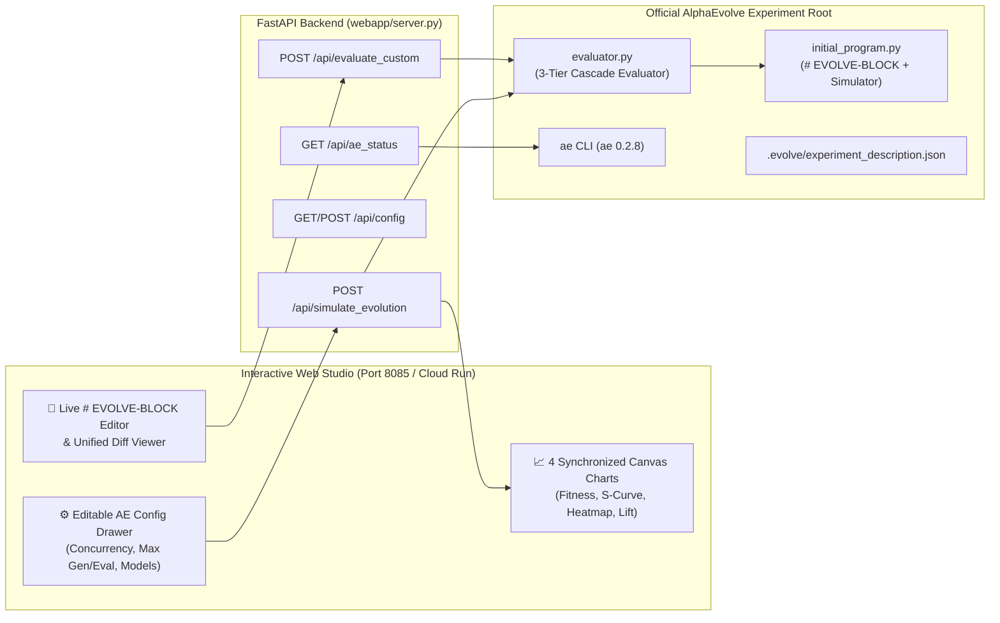

# 🧬 Circana Liquid Data® × AlphaEvolve — Omni-Channel Retail Media Flighting & iROAS Optimizer

[](https://circana-alpha-evolve-943928157761.us-central1.run.app)
[](https://circana-alpha-evolve-943928157761.us-central1.run.app)
[](#6-testing--verification)

> **Live Cloud Run Application:** **https://circana-alpha-evolve-943928157761.us-central1.run.app**  
> **Alternate Cloud Run URL:** **https://circana-alpha-evolve-ns6bqifvaq-uc.a.run.app**  
> **Local Studio URL:** **http://localhost:8085**

---

## 🎬 Running Application Video Walkthrough

The video below is recorded directly from the live **Google Cloud Run** deployment (`https://circana-alpha-evolve-943928157761.us-central1.run.app`). It demonstrates:
1. **Scene 1 — Evolutionary Milestone Progression**: Stepping from the naive uniform seed program (`Score: 196.49`, `+$6.82M` lift) across 5 evolved milestones to the best discovered coordinate-ascent algorithm (`Score: 522.33`, **`+165.8%`**, `+$16.72M` lift, `6.69x` iROAS).
2. **Scene 2 — Live AlphaEvolve Configuration Editing**: Modifying **Concurrency (`--concurrency 20`)**, **Max Programs Generated (`--max-programs 250`)**, **Max Programs Evaluated (`--max-iterations 180`)**, and **Campaign Budget (`$3.00M`)** in the GUI and re-running the real 3-tier `evaluator.py` backend.
3. **Scene 3 — Live `# EVOLVE-BLOCK` Python Sandbox & Diff Inspector**: Inspecting the evolved Python algorithm, viewing the unified diff against `initial_program.py`, inspecting the generated `ae` CLI commands, and evaluating custom Python code in real time.

<video src="webapp/static/demo_walkthrough.mp4" poster="webapp/static/demo_poster.png" controls autoplay loop muted playsinline width="100%">
  <source src="webapp/static/demo_walkthrough.mp4" type="video/mp4" />
  <source src="webapp/static/demo_walkthrough.webm" type="video/webm" />
</video>


*Direct video files in repository: [`webapp/static/demo_walkthrough.mp4`](webapp/static/demo_walkthrough.mp4) • [`webapp/static/demo_walkthrough.webm`](webapp/static/demo_walkthrough.webm) • [`webapp/static/demo_walkthrough.gif`](webapp/static/demo_walkthrough.gif) • [`webapp/static/demo_poster.png`](webapp/static/demo_poster.png)*

---

## 1. Executive Summary & Circana Use Case

**Circana** (formerly IRI + NPD) powers closed-loop CPG retail media attribution through **Liquid Data®**, linking verified household point-of-sale (POS) scanner data across 30+ million loyalty cards with multi-retailer ad exposure.

A flagship optimization challenge for CPG brands using Circana is **Omni-Channel Retail Media Flighting**: allocating a **$2.50M quarterly promotional budget** across **5 Retail Media Networks (RMNs)** over an **8-week back-to-school / holiday demand window**:
1. **Walmart Connect**
2. **Target Roundel**
3. **Kroger Precision Marketing (KPM)**
4. **Instacart Ads**
5. **Amazon Fresh / Whole Foods**

### Why Traditional Linear MMM & Convex Solvers Fail
Standard continuous media-mix models smear budget evenly across weeks and retailers (`$62.5k` per cell). In real CPG retail media, uniform smearing destroys incremental Return on Ad Spend (**iROAS**) due to four coupled, non-convex dynamics:

| Real-World Retail Dynamic | Mathematical Mechanism in Simulator | Consequence of Naive Uniform Allocation |
| :--- | :--- | :--- |
| **1. S-Curve Ad Thresholds & Saturation** | Non-convex Hill response $H_r(b) = \frac{b^{n_r}}{\kappa_r^{n_r} + b^{n_r}}$ with $n_r \in [3.1, 3.25]$ | Sub-threshold micro-spends ($b < 0.75\kappa_r$) fall in the **dead zone** and generate near-zero incremental lift. |
| **2. 3-Week Pantry-Depletion Cannibalization** | Post-promo dip multiplier $P_{r,t} = \max\left(0.22, 1 - \sum_{d=1}^{2} \omega_d \text{pulse}_{r,t-d}\right)$ | Promoting the same category in consecutive weeks merely pulls forward future baseline purchases from already-stocked household pantries. |
| **3. Cross-RMN Household Overlap** | Cross-retailer loyalty card overlap matrix $\Omega_{r,k}$ (`Walmart ↔ Target = 28%`, `Walmart ↔ Kroger = 22%`) | Simultaneous heavy pulses on overlapping retailers saturate the same multi-store households. |
| **4. Store Inventory Out-of-Stock (OOS) Caps** | Hard supply-chain ceiling $I_{r,t}$ (`inventory_cap_musd`) with $2.4\times$ wasted-ad-spend penalty | Driving promotional velocity into a supply-constrained week wastes retail media dollars on empty shelves. |

### Why AlphaEvolve Is Ideal
Instead of black-box parameter tuning, **AlphaEvolve** evolves the **actual Python flighting algorithm** inside [`initial_program.py`](initial_program.py) (`# EVOLVE-BLOCK-START` ... `# EVOLVE-BLOCK-END`). Every mutated program is scored by the deterministic 3-tier [`evaluator.py`](evaluator.py) across multiple CPG category scenarios (`Snacks & Beverages`, `Household Cleaning`, and `Frozen Meals`), returning rich diagnostic `insights` that guide the next generation of Gemini code mutations.

---

## 2. Evolutionary Progression & Discovered Milestones

All 6 algorithmic milestones below are evaluated **live** by [`evaluator.py`](evaluator.py) when you launch the studio or adjust campaign parameters:

| Stage | Candidate Nickname | Evaluations | Model Generator | Key Algorithmic Discovery in `# EVOLVE-BLOCK` | AE Fitness Score | Net Sales Lift ($M) | Campaign iROAS | Ad / Pantry / OOS Waste |
| :---: | :--- | :---: | :--- | :--- | :---: | :---: | :---: | :---: |
| **Gen 0** | `seed-uniform-smear` | `1 / 100` | `initial_program.py` | Uniform weekly split proportional to RMN capacity; ignores S-curves, pantry cooldown, and OOS caps. | **196.49** | `+$6.82M` | `2.73x` | `55.7%` |
| **Milestone 1** | `amber-falcon-18` | `18 / 100` | `gemini-3.5-flash` | **Hill S-Curve Inflection Pulsing**: Concentrates spend into `1.25x` $\kappa_r$ pulses during peak seasonality weeks. | **379.11** | `+$12.44M` | `4.97x` | `41.4%` |
| **Milestone 2** | `cobalt-otter-38` | `38 / 100` | `gemini-3.5-flash` | **Store OOS Inventory Gating**: Detects supply-constrained retailer weeks (`inventory_cap_musd`) and shifts flights away from OOS bottlenecks. | **435.40** | `+$14.14M` | `5.66x` | `34.9%` |
| **Milestone 3** | `emerald-lynx-62` | `62 / 100` | `gemini-3.1-pro-preview` | **3-Week Pantry Cooldown Spacing**: Enforces a minimum 2-to-3 week gap between pulses on the same RMN so household pantries deplete before re-promoting. | **482.74** | `+$15.55M` | `6.22x` | `26.6%` |
| **Milestone 4** | `sapphire-titan-84` | `84 / 100` | `gemini-4-argon` | **Cross-RMN Household Overlap Deduplication**: Uses `overlap_matrix` to stagger Walmart Connect, Target Roundel, and Kroger onto non-colliding weeks. | **495.88** | `+$15.94M` | `6.38x` | `24.6%` |
| **Milestone 5** | `nova-phoenix-100` | `100 / 100` | `gemini-4-argon` | **Combinatorial Pulse Search + Marginal Coordinate Ascent**: Pairs discrete pulse selection with 180 iterations of exact marginal-iROAS dollar reallocation. | **522.33** (**`+165.8%`**) | **`+$16.72M`** | **`6.69x`** | **`19.7%`** |

---

## 3. Interactive GUI Features & Editable AlphaEvolve Configurations

### Left Configuration Drawer (Editable in Real Time)
Every AlphaEvolve runtime parameter and Circana campaign constraint is exposed and editable in the left sidebar of the GUI:

1. **Evolutionary Run Settings (`RunSettings`)**:
   - **Concurrency (`--concurrency`)**: Number of parallel candidate generators & local evaluators (`1–30`, default `10`).
   - **Max Programs Generated (`--max-programs`)**: Server-side cap on total LLM-mutated programs generated (`2–5000`, default `100`).
   - **Max Programs Evaluated (`--max-iterations`)**: Client-side evaluation loop cap (`0 = unlimited`, default `100`).
   - **Eval Timeout (`--timeout`)**: Per-candidate execution kill timer in seconds (`5–3600s`, default `60s`).
   - **Eval Sandbox (`--backend`)**: `local` (`uv` virtual environment) or `podman` (rootless container).
   - **Island Reset Interval**: Evolutionary population island reset interval (`5–500`, default `25`).
2. **LLM Ensemble Mixture (`--models`)**:
   - Preset selector for **90/10 Flash + Pro Mixture** (`gemini-3.5-flash:0.9,gemini-3.1-pro-preview:0.1`), **API Default**, **Pinned `gemini-4-argon`**, **Pinned `gemini-3.5-flash`**, or **Custom Dual-Model Weights**.
3. **Circana Liquid Data® Campaign Setup**:
   - **Total Budget ($M)** (`$0.50M – $15.00M`, default `$2.50M`)
   - **Minimum Active Flight ($M)** (`$0.00M – $0.25M`, default `$0.025M`)
   - **Household Pantry Cooldown Cycle (Weeks)** (`1–6 weeks`, default `3 weeks`)
4. **GCP & Discovery Engine (`ae config`)**:
   - **GCP Project (`--project`)** and **Discovery Engine ID (`--engine`)**, which dynamically update the generated `ae` CLI commands at the bottom of the studio.

### 4 Synchronized Visual Optimization Charts
1. **Chart 1 — Evolutionary Fitness Progression (`fitness_score`)**: Plots individual candidate evaluations (blue dots), failed/timed-out mutations (`red ×`), and the monotonically rising **Elite Frontier** step-curve across evaluations `1 .. max_iterations`.
2. **Chart 2 — Retail Media Hill S-Curve Operating Points**: Plots the theoretical Hill S-curve response and overlays all 40 active `(RMN, Week)` flight allocations so you can watch points migrate out of the sub-threshold dead zone into the optimal inflection knee (`1.1x–1.6x` $\kappa_r$).
3. **Chart 3 — 8-Week × 5-RMN Omni-Channel Flighting Plan ($k)**: Color-coded matrix across **Walmart Connect**, **Target Roundel**, **Kroger PM**, **Instacart Ads**, and **Amazon Fresh**, highlighting optimal pulses (emerald), sub-optimal smears (amber), pantry cooldown rests (dark slate), and `OOS CAP` inventory limits.
4. **Chart 4 — Cumulative Weekly Incremental Sales Lift ($M)**: Compares the 8-week cumulative dollar sales lift of the active evolved program (solid emerald curve) against the Gen 0 uniform seed baseline (dashed gray curve).

---

## 4. System Architecture & Repository Layout



### Directory Structure
```text
circan_alpha_evolve/
├── .evolve/
│   ├── experiment_description.json   # Official AlphaEvolve ExperimentDescription schema
│   └── gui_config.json               # Persisted GUI runtime & campaign configuration
├── webapp/
│   ├── __init__.py
│   ├── server.py                     # FastAPI server driving real-time evaluator & GUI APIs
│   └── static/
│       ├── index.html                # Studio UI layout
│       ├── styles.css                # Dark-mode executive theme
│       ├── app.js                    # HTML5 Canvas charts & interactive state engine
│       ├── demo_walkthrough.mp4      # Recorded Cloud Run walkthrough video (MP4)
│       ├── demo_walkthrough.webm     # Recorded Cloud Run walkthrough video (WebM)
│       ├── demo_walkthrough.gif      # Animated GIF inline walkthrough preview
│       └── demo_poster.png           # High-res poster frame
├── initial_program.py                # Seed program with # EVOLVE-BLOCK-START / END
├── evaluator.py                      # 3-tier CLI & library evaluator (Validation -> Verification -> Evaluation)
├── problem_description.md            # Natural-language prompt context for AlphaEvolve LLMs
├── example_evaluation.json           # Verified baseline score output from `ae program evaluate`
├── test_program.py                   # Unit tests for initial_program.py
├── test_evaluator.py                 # Unit tests for evaluator.py
├── pyproject.toml                    # uv Python project configuration
├── requirements.txt                  # Cloud Run / Docker Python dependencies
├── Dockerfile                        # Production container image definition
├── deploy.sh                         # One-command Google Cloud Run deployment script
└── README.md                         # This documentation
```

> [!NOTE]
> Keeping `webapp/server.py` inside the `webapp/` subdirectory ensures that running `ae experiment start --program-dir .` only bundles `initial_program.py` from the root directory without polluting the AlphaEvolve LLM prompt context with web server code.

---

## 5. Quick Start — Run Locally or Deploy to Cloud Run

### Run Locally with `uv`
```bash
cd /usr/local/google/home/elhadik/elhadik/circan_alpha_evolve
uv sync
uv run uvicorn webapp.server:app --host 0.0.0.0 --port 8085
```
Open **http://localhost:8085** in your browser.

### Deploy to Google Cloud Run (1 Command)
```bash
cd /usr/local/google/home/elhadik/elhadik/circan_alpha_evolve
chmod +x deploy.sh
./deploy.sh shade-sandbox us-central1
```

---

## 6. Testing & Verification

### Run Unit & Evaluator Pytest Suite
```bash
cd /usr/local/google/home/elhadik/elhadik/circan_alpha_evolve
uv run pytest -v
```

### Run Official `ae` CLI Local Sandbox Verification
```bash
cd /usr/local/google/home/elhadik/elhadik/circan_alpha_evolve
ae --json program evaluate \
  --program-dir . \
  --evaluator evaluator.py \
  --backend local \
  --timeout 60 > example_evaluation.json
```

### Launch a Live Cloud AlphaEvolve Experiment via `ae` CLI
```bash
ae config init \
  --project YOUR_GCP_PROJECT \
  --engine YOUR_DISCOVERY_ENGINE_ID \
  --models "gemini-3.5-flash:0.9,gemini-3.1-pro-preview:0.1"

ae --json experiment create \
  --concurrency 10 \
  --max-programs 100 \
  --problem-file problem_description.md \
  --title "Circana Omni-Channel RMN Flighting Optimizer"

ae --json experiment start <nickname> \
  --program-dir . \
  --score 196.4941

ae --json experiment run <nickname> \
  --evaluator evaluator.py \
  --backend local \
  --timeout 60 \
  --max-iterations 100 \
  --dashboard <nickname>-dashboard.md
```
