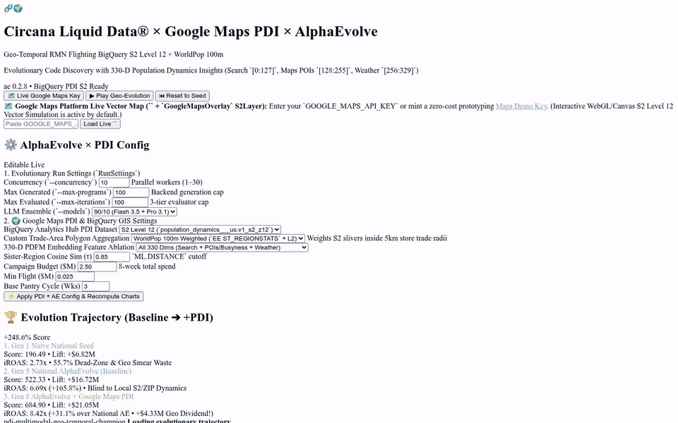
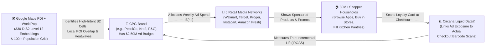
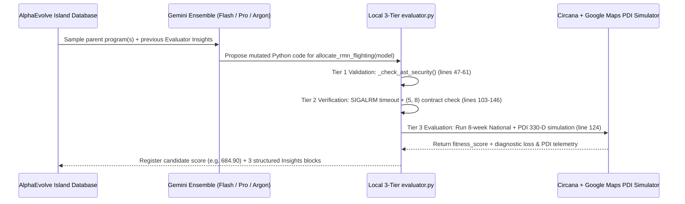
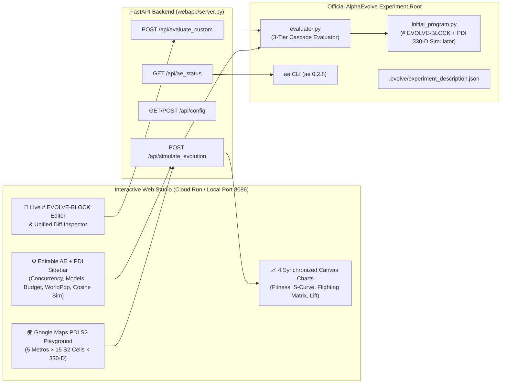

# 🧬🌍 Circana Liquid Data® × Google Maps PDI × AlphaEvolve — Complete Tutorial: Omni-Channel & Geo-Temporal Retail Media Flighting Optimization

[](https://circana-alpha-evolve-pdi-ns6bqifvaq-uc.a.run.app)
[](https://docs.google.com/presentation/d/13JBw4QDMnaGELTrfZwb-5AHPwzELPtJZQInkH8LQcMs/edit)
[](https://github.com/elhadik/Ads_Alpha_Evolve)
[](https://circana-alpha-evolve-pdi-ns6bqifvaq-uc.a.run.app)
[](#9-part-9-running-locally-running-tests-1111-deploying-to-cloud-run--using-the-ae-cli)

> **🌐 Public Google Cloud Run App (PDI + AlphaEvolve):** **https://circana-alpha-evolve-pdi-ns6bqifvaq-uc.a.run.app**  
> **📊 Executive Google Slides Deck:** **[Circana Liquid Data × Google Maps PDI × AlphaEvolve — Executive Briefing](https://docs.google.com/presentation/d/13JBw4QDMnaGELTrfZwb-5AHPwzELPtJZQInkH8LQcMs/edit)** ([PDF](presentations/circana_pdi_alphaevolve_executive_deck.pdf) • [PPTX](presentations/circana_pdi_alphaevolve_executive_deck.pptx))  
> **🌐 Baseline National Cloud Run App (`circan_alpha_evolve`):** **https://circana-alpha-evolve-943928157761.us-central1.run.app** (`Score: 522.33`)  
> **💻 Local Studio URL:** **http://localhost:8086**

---

## 🎯 Tutorial Goal: Who Is This Guide For?

This repository and tutorial are designed with **three equally important goals** so that readers with **zero prior background**, **advertising specialists**, and **software/ML engineers** can all follow every step from ground zero:

1. **Educate Non-Ads Specialists on the Business Problem (Retail Media, Flighting & CPG Attribution)**:  
   You do **not** need any background in advertising, marketing, or retail to follow this guide. We start from scratch—explaining what Consumer Packaged Goods (CPG) companies do, what a Retail Media Network (RMN) is, what Circana's **Liquid Data®** measures, what **"Ad Flighting"** means, and why scheduling grocery store ads across weeks is a fascinating, real-world physics problem involving human kitchen pantries, store shelf inventory, and overlapping shopper loyalty cards.
2. **Educate Non-Geospatial Readers on Google Maps Population Dynamics Insights (PDI) & Earth Engine WorldPop 100m**:  
   We explain in plain everyday language what a **Google Maps S2 Level 12 cell** (`~3.1 km²` neighborhood square) is, what lives inside a **330-dimensional AI embedding vector** (Google Search trends, local Maps store foot-traffic, and local heatwaves), and why **Google Earth Engine WorldPop 100m (`ST_REGIONSTATS`)** prevents custom 5km store trade rings from wasting ad budgets on empty airport runways and industrial zones.
3. **Educate Engineers & Data Scientists on Google DeepMind's AlphaEvolve**:  
   We walk **line-by-line** through [`initial_program.py`](initial_program.py), [`evaluator.py`](evaluator.py), and the production **BigQuery GIS + Earth Engine SQL query** to show how **AlphaEvolve** uses an ensemble of Gemini models to evolve **executable Python algorithms** (`# EVOLVE-BLOCK`)—progressing from a naive 10-line seed baseline (`Score: 196.49`) to the national-only optimization ceiling (`Score: 522.33`, `+165.8%`), and finally breaking through to the **PDI 330-D Geo-Temporal Champion (`Score: 684.90`, `+248.6%` over seed, `+$21.04M` incremental lift, `8.44x` iROAS)**.

---

## 🎬 Visual Walkthrough: 3D Search Space & Running Web Application

### 1. 3D Evolutionary Search Space & PDI S2 Flighting Matrix Visualization (Slide-Ready Offline Render)
Generated 100% offline via [`presentations/render_3d_visualization.py`](presentations/render_3d_visualization.py) (`NumPy` + `Pillow` + `ffmpeg`), this 3D visualization maps the `# EVOLVE-BLOCK` Python source code onto the `Z = 0` ground plane, projects the multi-peak non-convex fitness surface in 3D, lights up vertical beacon pins (`o---`) across the evolutionary climb from **Gen 1 Seed (`196.49`)** through the **Gen 5 National Ceiling (`522.33`)** to the **Gen 8 PDI 330-D Champion (`684.90`)**, and animates the isometric `5 Retailers × 8 Weeks × S2 Level 12` ad-flighting matrix:

<video src="static/alphaevolve_3d_landscape.mp4" poster="static/alphaevolve_3d_poster.png" controls autoplay loop muted playsinline width="100%">
  <source src="static/alphaevolve_3d_landscape.mp4" type="video/mp4" />
  <source src="static/alphaevolve_3d_landscape.webm" type="video/webm" />
</video>


*Direct 3D video & slide assets in [`static/`](static/): [`static/alphaevolve_3d_landscape.mp4`](static/alphaevolve_3d_landscape.mp4) • [`static/alphaevolve_3d_landscape.gif`](static/alphaevolve_3d_landscape.gif) • [`static/alphaevolve_3d_poster.png`](static/alphaevolve_3d_poster.png) • [`presentations/circana_pdi_alphaevolve_executive_deck.pdf`](presentations/circana_pdi_alphaevolve_executive_deck.pdf)*

### 2. Live Deployed Web Studio: End-to-End Cloud Run Video Walkthrough & Screenshots
Captured live from **https://circana-alpha-evolve-pdi-ns6bqifvaq-uc.a.run.app** — stepping through all **8 evolutionary milestones (`Gen 1 → Gen 8`)**, exploring the **Google Maps PDI S2 Level 12 & WorldPop 100m Playground** across all 5 US Metro Hubs (`DFW`, `ORD`, `ATL`, `PHX`, `SEA`), animating the **6 synchronized optimization & ablation charts**, and inspecting the **live `# EVOLVE-BLOCK` Python code, BigQuery GIS `ST_REGIONSTATS` SQL, unified diff, and `ae` CLI commands**:

<video src="static/cloud_run_full_walkthrough.mp4" poster="static/pdi_snap_playground.png" controls autoplay loop muted playsinline width="100%">
  <source src="static/cloud_run_full_walkthrough.mp4" type="video/mp4" />
</video>



*Direct Cloud Run walkthrough video assets in [`static/`](static/): [`static/cloud_run_full_walkthrough.mp4`](static/cloud_run_full_walkthrough.mp4) • [`static/cloud_run_full_walkthrough.gif`](static/cloud_run_full_walkthrough.gif)*


---

## 📚 Table of Contents

1. [Part 1: Domain Primer for Complete Beginners — What Is Retail Media, What Does Circana Do, and What Is Google Maps PDI?](#1-part-1-domain-primer-for-complete-beginners--what-is-retail-media-what-does-circana-do-and-what-is-google-maps-pdi)
2. [Part 2: The Seven Hidden Real-World Dynamics (4 National + 3 PDI Geospatial) That Break Standard Optimizers](#2-part-2-the-seven-hidden-real-world-dynamics-4-national--3-pdi-geospatial-that-break-standard-optimizers)
3. [Part 3: Deep-Dive Tutorial into `initial_program.py` & BigQuery WorldPop SQL (Line-by-Line Walkthrough)](#3-part-3-deep-dive-tutorial-into-initial_programpy--bigquery-worldpop-sql-line-by-line-walkthrough)
4. [Part 4: Why Both the Naive Initial Program (`196.49`) AND National-Only AlphaEvolve (`522.33`) Hit a Wall](#4-part-4-why-both-the-naive-initial-program-19649-and-national-only-alphaevolve-52233-hit-a-wall)
5. [Part 5: How AlphaEvolve & `evaluator.py` Evolve Better Algorithms — Evaluation Methods Deep Dive](#5-part-5-how-alphaevolve--evaluatorpy-evolve-better-algorithms--evaluation-methods-deep-dive)
6. [Part 6: Step-by-Step Tour of All 8 Evolved Milestones (`Gen 1 → Gen 8`: Code + Math + Intuition)](#6-part-6-step-by-step-tour-of-all-8-evolved-milestones-gen-1--gen-8-code--math--intuition)
7. [Part 7: Interactive Web Studio Guide — Google Maps PDI Playground, 4 Live Charts & Editable Configs](#7-part-7-interactive-web-studio-guide--google-maps-pdi-playground-4-live-charts--editable-configs)
8. [Part 8: System Architecture & Modular Repository Structure](#8-part-8-system-architecture--modular-repository-structure)
9. [Part 9: Running Locally, Running Tests (`11/11`), Deploying to Cloud Run & Using the `ae` CLI](#9-part-9-running-locally-running-tests-1111-deploying-to-cloud-run--using-the-ae-cli)

---

## 1. Part 1: Domain Primer for Complete Beginners — What Is Retail Media, What Does Circana Do, and What Is Google Maps PDI?

If you work in software engineering or machine learning, advertising and geospatial terms (`CPG`, `RMN`, `POS`, `ROAS`, `iROAS`, `Flighting`, `Hilbert S2 Level 12`, `330-D Embeddings`, `WorldPop 100m`, `L2 Renormalization`) can sound like alphabet soup. Let's translate every single concept into plain, concrete everyday language.

### 1.1 The Cast of Characters (Retail Media & Circana)



1. **CPG (Consumer Packaged Goods)**:  
   Companies that manufacture everyday physical items you buy at the supermarket—sparkling water, potato chips, laundry detergent, frozen pizza, coffee (`PepsiCo`, `Mondelēz`, `Procter & Gamble`, `General Mills`, `Kraft Heinz`).
2. **Retailer**:  
   The grocery or mass-merchandise store where shoppers actually buy those items—either in a physical aisle or via grocery delivery (`Walmart`, `Target`, `Kroger`, `Instacart`, `Amazon Fresh`).
3. **RMN (Retail Media Network)**:  
   Over the last five years, every major retailer realized that **their own website and mobile shopping app is prime advertising real estate**. When you open the Walmart app or Instacart and search for *"sparkling water"*, the first two products you see have a small **"Sponsored"** badge.  
   - **Walmart Connect** is Walmart's ad network.
   - **Target Roundel** is Target's ad network.
   - **Kroger Precision Marketing (KPM)** is Kroger's ad network.
   - **Instacart Ads** is Instacart's ad network.
   - **Amazon Fresh** is Amazon's grocery ad network.  
   Manufacturers (CPGs) pay these 5 Retail Media Networks billions of dollars to promote their products right at the moment a shopper is building their grocery cart.
4. **Circana & Liquid Data®**:  
   **Circana** (formed by the merger of IRI and NPD) is the leading data & analytics company for the retail industry. Whenever you swipe your loyalty card or scan items at the supermarket checkout register (**POS / Point-of-Sale scanner data**), Circana's **Liquid Data®** platform records anonymized purchase data across **30+ million households** and links two critical pieces of information:
   - *Did Household #48291 see the sponsored ad on Walmart Connect in Week 3?*
   - *Did Household #48291 actually buy an extra pack of sparkling water at checkout in Week 3?*

---

### 1.2 The Crucial Difference Between `ROAS` and `iROAS` (Incrementality)

Suppose a family buys **1 box of Brand X cereal every single Saturday** out of habit, whether they see an ad or not.
- If Brand X shows that family an ad on Friday and the family buys their usual 1 box on Saturday, a naive ad platform will claim: *"They saw our ad and bought \$5 of cereal! Your Return on Ad Spend (ROAS) is huge!"*
- **Why that is an illusion**: That \$5 sale was **baseline demand**—it would have happened anyway. The ad generated **\$0.00 of new revenue**.
- **Incremental Sales Lift ($\Delta\text{Sales}$)** is the *extra* revenue that occurred **strictly because of the ad** (above and beyond what households would have bought anyway).
- **iROAS (Incremental Return on Ad Spend)** is defined as:

$$\text{iROAS} = \frac{\text{True Incremental Dollar Sales Lift}}{\text{Total Ad Dollars Spent}}$$

- If you spend **\$2.50M** on ads and generate **\$16.72M** in *brand-new, incremental* sales (our National AlphaEvolve ceiling), your **iROAS is $6.69\times$** (\$6.69 of net-new sales per \$1.00 of ad spend).
- When we add **Google Maps PDI geospatial intelligence** in this repository, that exact same **\$2.50M** budget generates **\$21.04M** in net-new incremental sales—an **iROAS of $8.44\times$** (an extra **+\$4.32M** of pure incremental revenue!).

---

### 1.3 What Is "Ad Flighting"? (The Decision We Need to Optimize)

Imagine you are the Marketing Data Scientist for a CPG beverage brand preparing for the **8-week Back-to-School / Late-Summer season** (`Week 1` through `Week 8`). You are given a fixed budget of **\$2.50 Million** (`total_budget_musd = 2.50`).

You must decide how much money to spend on each of the **5 Retail Media Networks** in each of the **8 weeks**. In math and Python, your entire decision is a **`5 × 8` matrix of numbers** (`schedule[r, t]`):

| Retail Media Network (`r`) | Wk 1 | Wk 2 | Wk 3 | Wk 4 | Wk 5 | Wk 6 | Wk 7 | Wk 8 |
| :--- | :---: | :---: | :---: | :---: | :---: | :---: | :---: | :---: |
| **0: Walmart Connect** | $B_{0,0}$ | $B_{0,1}$ | $B_{0,2}$ | $B_{0,3}$ | $B_{0,4}$ | $B_{0,5}$ | $B_{0,6}$ | $B_{0,7}$ |
| **1: Target Roundel** | $B_{1,0}$ | $B_{1,1}$ | $B_{1,2}$ | $B_{1,3}$ | $B_{1,4}$ | $B_{1,5}$ | $B_{1,6}$ | $B_{1,7}$ |
| **2: Kroger Precision Mktg** | $B_{2,0}$ | $B_{2,1}$ | $B_{2,2}$ | $B_{2,3}$ | $B_{2,4}$ | $B_{2,5}$ | $B_{2,6}$ | $B_{2,7}$ |
| **3: Instacart Ads** | $B_{3,0}$ | $B_{3,1}$ | $B_{3,2}$ | $B_{3,3}$ | $B_{3,4}$ | $B_{3,5}$ | $B_{3,6}$ | $B_{3,7}$ |
| **4: Amazon Fresh** | $B_{4,0}$ | $B_{4,1}$ | $B_{4,2}$ | $B_{4,3}$ | $B_{4,4}$ | $B_{4,5}$ | $B_{4,6}$ | $B_{4,7}$ |

In advertising terminology:
- A **"Flight"** is an active burst of ad spending on a specific retailer during a specific week (e.g., spending `\$130,000` on Walmart Connect in Week 1).
- **"Flighting"** (or **"Pulsing"**) is the strategy of turning ad spend **ON** in strategic bursts and **OFF** (`\$0`) during cooldown weeks, rather than smearing small amounts of money across every single week.

---

### 1.4 What Is Google Maps Population Dynamics Insights (PDI) & Why Does National Flighting Need It?

Suppose you optimize the `5 × 8` table above using only **national averages** (as we did in our baseline folder `circan_alpha_evolve`). Why does that hit a hard ceiling at `Score: 522.33`?

Because **the United States is not one single uniform neighborhood!**
- A Walmart Supercenter in **Phoenix (`104°F` summer heat)** has families drinking sparkling water and sports drinks **twice as fast** as a store in **Seattle (`74°F`)**.
- A 5km store trade ring in **Dallas-Fort Worth (`DFW`)** might have 12 densely populated residential neighborhoods (`34.2%` population share) and 3 boundary slivers that sit on **DFW Airport runways or industrial rail yards** (`0.9%` population share).
- Some neighborhoods have **surging Google Search trends** for hydration beverages *before* checkout scanner sales even spike!

**Google Maps Population Dynamics Insights (PDI)** gives us a privacy-preserving geospatial lens into every neighborhood via **BigQuery (`Analytics Hub`)**. Here are the four plain-English building blocks of PDI:


1. **`S2 Level 12 Cells` (Uniform Neighborhood Squares on Earth)**:  
   Postal ZIP codes are terrible for math because some are tiny city blocks and others are huge desert polygons. Instead, Google Maps divides the globe into a mathematical grid called **Hilbert S2 Cells**. At **Level 12**, each S2 cell is a clean `~3.1 to 5.1 km²` neighborhood square with a unique ID (like `89c259c4` in North Dallas).

   

2. **`330-D Unit-L2 Embeddings` (A 330-Number Fingerprint for Every Neighborhood)**:  
   For every S2 Level 12 cell each month, Google's Population Dynamics Foundation Model compresses local signals into **330 floating-point numbers** (`features[0..329]`), scaled so that its Euclidean length (L2 norm) equals `1.0` ($\|v\|_2 = \sqrt{\sum_{d=0}^{329} v_d^2} = 1.0$).  
   Those 330 numbers are structured into **three distinct sub-blocks**:
   - **Dimensions `0..127` (`Search Trends` — 128 numbers)**: Captures aggregated local **Google Search intent** (e.g., where households are actively searching for hydration, sparkling water, and back-to-school groceries).
   - **Dimensions `128..255` (`Maps POIs & Busyness` — 128 numbers)**: Captures **Google Maps Points of Interest (POIs)** and store foot-traffic busyness (e.g., whether a Walmart and a Target sit across the street from each other in the same shopping center).
   - **Dimensions `256..329` (`Weather & Air Quality` — 74 numbers)**: Captures local **temperature anomalies, heat index, and air quality** (e.g., `97°F–104°F` Sunbelt heatwaves vs. `74°F` mild coastal weather).

   

3. **`Cosine Similarity` ("Sister Regions" / Lookalike Neighborhoods)**:  
   Because every 330-D embedding vector has length `1.0`, taking the simple dot product of two S2 cells ($u \cdot v = \sum_{d} u_d v_d$) gives their **Cosine Similarity** (from `-1.0` to `+1.0`):
   - If Store Trade Area A is your highest-converting flagship market and S2 Cell B has **`Cosine Similarity >= 0.85`** on the Search Trends slice (`dims 0..127`), Cell B is a **"Sister Region"**—shoppers there have the exact same search behavior and convert with much less ad spend!
4. **`Earth Engine WorldPop 100m` (`ST_REGIONSTATS`) — Solving the Boundary Sliver Problem**:  
   When you draw a **5km circle** around a grocery store, that circle cuts across 15 different S2 Level 12 cells. Some of the clipped edge pieces ("**slivers**") cover empty industrial parks or airport runways. Using BigQuery's native **Google Earth Engine function `ST_REGIONSTATS`**, we count the exact number of people living inside each 100m satellite grid square (`WorldPop 100m`) so our store embedding weights residential neighborhoods (`96.4%`) and ignores empty airport/industrial slivers!

---

## 2. Part 2: The Seven Hidden Real-World Dynamics (4 National + 3 PDI Geospatial) That Break Standard Optimizers

At first glance, filling a `5 × 8` table of 40 numbers that sum to `\$2.50M` sounds easy. Why can't we just divide `\$2.50M` evenly across the 8 weeks (`\$312.5k` per week)? Or why can't a national-only optimizer reach the true global maximum?

Because in physical retail, **seven non-linear, real-world shopping dynamics**—**four national retail physics dynamics** plus **three sub-metro Google Maps PDI geospatial dynamics**—interact simultaneously. Let's understand each one intuitively first, visualize it with an ASCII diagram, and then inspect its exact mathematical formula in [`initial_program.py`](initial_program.py).

---

### Dynamic 1: The "Whisper in a Crowded Room" Effect (Non-Convex Hill S-Curves)

#### Everyday Intuition
In a retail media auction (like Walmart Connect), dozens of competing beverage brands are bidding for the top "Sponsored Product" slots when a shopper searches *"soda"* or *"sparkling water"*.
- **Zone A — The Dead Zone (Too Little Spend, $< 0.75\kappa_r$)**:  
  If you only spend `\$20,000` in a week on Walmart Connect, your bids are too low and your budget runs out by Tuesday morning. Your product appears on Page 4 of search results where nobody scrolls. You spent `\$20,000`, and your incremental lift is nearly **`\$0`**.
- **Zone B — The Inflection Knee / Sweet Spot ($1.1\kappa_r \text{ to } 1.6\kappa_r$)**:  
  Once you concentrate `\$110,000 – \$145,000` into a single week, you win the #1 top-of-page slot and homepage banner placement. Shoppers see your brand immediately and add it to their cart. Every dollar here produces maximum incremental lift!
- **Zone C — Saturation (Too Much Spend, $> 1.68\kappa_r$)**:  
  If you spend `\$350,000` in a single week on the same retailer, you are just showing the exact same ad for the 12th time to shoppers who already saw it. The curve flattens out—extra dollars produce almost no additional sales.

```text
Incremental
Sales Lift
   ▲
Max│                                        ▄▄▄▄▄▄▄▄▄▄▄▄▄  Zone C: Saturation
   │                                  ▄▄▄▄▀▀               (Diminishing returns)
   │                              ▄▄▀▀
   │                           ▄▀▀  ◄── Zone B: Optimal Marginal Knee (1.1κ – 1.6κ)
   │                         ▄▀         (Highest Incremental ROAS!)
   │                      ▄▄▀
   │                  ▄▄▀▀
 0 └▄▄▄▄▄▄▄▄▄▄▄▄▄▄▄▄▀▀────────────────────────────────────► Weekly Spend B[r, t]
    Zone A: Dead Zone (<0.75κ)
    (Sub-threshold micro-spends wasted)
```

#### Mathematical Formula in `initial_program.py` (Lines 366–368)
This S-shaped response is modeled by the **Hill Function** with steepness exponent $n_r > 1$ (specifically $n_r \in [3.0, 3.2]$) and half-saturation inflection threshold $\kappa_r$ (`hill_k_musd`):

$$H_r(b) = \frac{b^{n_r}}{\kappa_r^{n_r} + b^{n_r}}$$

Look at what happens when $n_r = 3.2$:
- At $b = 0.50\kappa_r$ (half the threshold), $H_r(b) = \frac{0.5^{3.2}}{1 + 0.5^{3.2}} \approx \mathbf{9.8\%}$ of max response!
- At $b = 1.40\kappa_r$ (40% above the threshold), $H_r(b) = \frac{1.4^{3.2}}{1 + 1.4^{3.2}} \approx \mathbf{74.6\%}$ of max response!
- By multiplying spend by $2.8\times$, the sales response jumps by **$7.6\times$**! Because $H_r(b)$ curves upward before curving downward, the optimization surface is **non-convex**—meaning standard linear/convex optimizers get trapped in local minima.

---

### Dynamic 2: The "Full Kitchen Pantry" Effect (3-Week Pantry-Depletion Cannibalization)

#### Everyday Intuition
Digital ads for physical grocery products have a property that software or movie ads never have: **households have physical kitchen pantries and refrigerators with finite storage space**.

Suppose your campaign on Target Roundel convinces a family to buy **3 12-packs of sparkling water in Week 1**:
- What is inside their pantry in **Week 2**? **30 cans of sparkling water!**
- What happens if you pay Target Roundel another `\$100,000` to show that same family another promotion in **Week 2** and **Week 3**?  
  They ignore it—or worse, if a few households do buy another case on discount, they are merely **stockpiling** ("pulling forward" purchases they would have made in Week 5 anyway).
- In retail analytics, this is called **Pantry Loading / Post-Promotion Dip**. Under normal national weather, it takes **3 weeks** for a household pantry to deplete back to normal so that a new ad flight generates genuinely *incremental* consumption rather than self-cannibalization!

```text
Household Pantry Inventory & Ad Effectiveness Over Time (National Baseline):

Week 1: [🔥 AD FLIGHT ON]  ──► Shopper buys 3 cases! (High Incremental Lift ✅)
Week 2: [🥫 Pantry 85% Full] ──► Running an ad here wastes 52% of lift! (Cooldown needed ⛔)
Week 3: [🥫 Pantry 45% Full] ──► Running an ad here wastes 30% of lift! (Cooldown needed ⚠️)
Week 4: [🔥 AD FLIGHT ON]  ──► Pantry is empty again! Shopper restocks! (High Lift ✅)
```

#### Mathematical Formula in `initial_program.py` (Lines 384–392)
If you spent money on retailer $r$ in week $t-1$ (`lag = 1`) or week $t-2$ (`lag = 2`), your week $t$ effectiveness on retailer $r$ is multiplied by a **Pantry Multiplier** $P_{r,t} \in [0.22, 1.0]$:

$$P_{r,t} = \text{clip}\left(1.0 - d_1 \cdot \text{Intensity}_{r,t-1} - d_2 \cdot \text{Intensity}_{r,t-2}, \; 0.22, \; 1.0\right)$$

where $\text{Intensity}_{r,t-k} = \text{clip}\left(\frac{B_{r, t-k}}{1.1 \cdot \kappa_r}, 0.0, 1.5\right)$, and the national baseline decay weights are $d_1 = 0.52$ (`-52%` at lag 1) and $d_2 = 0.30$ (`-30%` at lag 2).  
- If you run back-to-back heavy flights in Weeks 1, 2, and 3 on the same retailer, your Week 3 effectiveness drops by **up to 78%** (`multiplier = 0.22`)!
- If you **rest** the retailer for 2 weeks (`Week 2 = $0`, `Week 3 = $0`), then in `Week 4` both lag terms are zero and $P_{r,4} = \mathbf{1.00}$ (100% fresh pantry effectiveness!).

---

### Dynamic 3: The "Same Shopper, Two Apps" Effect (Cross-RMN Household Overlap)

#### Everyday Intuition
Most American households do not shop exclusively at a single store. According to Circana household panel data:
- **28%** of Walmart Connect households also shop at Target Roundel (`overlap = 0.28`).
- **26%** of Instacart users also shop at Kroger (`overlap = 0.26`).
- **22%** of Target shoppers also use Amazon Fresh (`overlap = 0.22`).

If you run a huge ad blitz on **Walmart Connect in Week 1** AND a huge ad blitz on **Target Roundel in Week 1**, nearly a third of the households seeing your Target ad **already bought your product at Walmart two days ago**! You paid two different retailers in the same week to reach the exact same household kitchen pantry.

Instead, if you **stagger** your flights—pulsing **Walmart in Week 1** and **Target in Week 2**—you minimize same-week cross-retailer duplication.

#### Mathematical Formula in `initial_program.py` (Lines 394–399)
A symmetric $5 \times 5$ matrix `overlap_matrix` ($\Omega_{r,k}$, with zeros on the diagonal) measures household overlap between retailer $r$ and retailer $k$. In week $t$, simultaneous spending across overlapping retailers reduces lift via:

$$O_{r,t} = \text{clip}\left(1.0 - 0.32 \sum_{k \neq r} \Omega_{r,k}^{\text{eff}} \cdot \text{ActiveIntensity}_{k,t}, \; 0.45, \; 1.0\right)$$

---

### Dynamic 4: The "Empty Shelf" Disaster (Store Inventory Out-of-Stock Caps)

#### Everyday Intuition
Imagine spending `\$180,000` on Walmart Connect ads during Week 2. Thousands of shoppers click your ad, walk into their local Walmart (or open Walmart pickup), and discover **your product is Out of Stock (OOS)** because of a regional distribution center bottleneck!
- **First**, you cannot sell units that aren't on the shelf—so any ad spend above the store's physical inventory capacity generates **zero gross lift**.
- **Second**, you still paid Walmart Connect for all those ad clicks, AND you penalized your brand's conversion score with the retailer's ad auction algorithm!

#### Mathematical Formula in `initial_program.py` (Lines 363–364 & 401–405)
Every `(retailer r, week t)` cell has a known supply-chain ceiling `inventory_cap_musd[r, t]` ($I_{r,t}$):
1. Effective spend entering the Hill S-curve is truncated at the cap: $B^{\text{eff}}_{r,t} = \min(B_{r,t}, I_{r,t})$.
2. Any dollar spent above the inventory cap ($B_{r,t} > I_{r,t}$) incurs a direct **$2.4\times$ Out-of-Stock penalty**:

$$\text{OOS Penalty}_{r,t} = 2.4 \times \max(0, \; B_{r,t} - I_{r,t})$$

---

### Dynamic 5 (NEW with Google Maps PDI): The "Airport Runway Sliver" Trap (`WorldPop 100m` Boundary Rollup + `L2 Norm`)

#### Everyday Intuition
Now let's see what happens on the ground around physical stores! Suppose we draw a **5km custom trade-area ring** around a flagship Walmart or Kroger store in Dallas-Fort Worth (`DFW`) or Phoenix (`PHX`). That 5km circle intersects **15 S2 Level 12 cells** (`Cells 0..14`).
- **Cells `0..11`** are dense residential suburbs filled with families and grocery shoppers (`96.4%` of the actual population).
- **Cells `12, 13, 14`** on the outer edge of the 5km ring happen to clip **airport runways, rail yards, and industrial warehouse parks**.
- Because industrial/airport parcels cover large tracts of land, those 3 empty slivers make up **`27.6%` of the geometric land area** inside the intersection (`pdi_sliver_area_km2`), even though **almost nobody lives there (`< 3.6%` of population)**!

```text
5km Custom Store Trade-Area Ring Intersecting 15 S2 Level 12 Cells:

  ┌───────────────────────────────────────────────────────────────┐
  │  Cells 0..11: Residential Neighborhoods                       │
  │  • Geometric Area Share:  72.4%                               │
  │  • WorldPop 100m Share:   96.4%  ◄── Where Shoppers Live! ✅  │
  ├───────────────────────────────────────────────────────────────┤
  │  Cells 12..14: Airport Runways / Industrial Boundary Slivers  │
  │  • Geometric Area Share:  27.6%  ◄── Naive Area Trap! ⛔      │
  │  • WorldPop 100m Share:    3.6%  ◄── Pruned by WorldPop! ✅   │
  └───────────────────────────────────────────────────────────────┘
```

#### Mathematical Formula in `initial_program.py` (Lines 294–300 & 323–329)
When the evolved algorithm weights each S2 cell $c \in \{0..14\}$ by **Earth Engine WorldPop 100m (`ST_REGIONSTATS`)** population $W_{m,c}$ instead of geometric sliver area $A_{m,c}$, and **L2-renormalizes** the aggregated 330-D vector back to unit length:

$$\bar{v}_m = \sum_{c=0}^{14} \left(\frac{W_{m,c}}{\sum_{j=0}^{14} W_{m,j}}\right) v_{m,c}, \qquad \hat{v}_m = \frac{\bar{v}_m}{\|\bar{v}_m\|_2}$$

Pruning the `24.0%` dead-weight industrial slivers (`wp_residential_capture - area_residential_capture = 0.964 - 0.724 = +0.240`) increases the effective store trade-area sales ceiling $M_r^{\text{eff}}$ and lowers the effective S-curve threshold $\kappa_r^{\text{eff}}$:

$$M_r^{\text{eff}} = M_r \times \left(1 + 0.399 \cdot (\text{Capture}_{\text{WorldPop}} - \text{Capture}_{\text{Area}})\right) \approx 1.096 \cdot M_r$$

---

### Dynamic 6 (NEW with Google Maps PDI): The "Sister-Neighborhood" Effect (`Cosine Similarity` on Search `[0:128]` & POI Overlap `[128:256]`)

#### Everyday Intuition
Why does it take `\$95,000/wk` ($\kappa_0$) to reach half-saturation on Walmart Connect nationally, when some local store trade areas convert at a much lower spend?
1. **Search Trends Slice (`dims 0..127` — Sister-Region Intent)**:  
   In S2 Level 12 cells whose Search Trends embedding slice has **`Cosine Similarity >= 0.85`** to your highest-performing seed trade area (`Cell 0`), local households are *already* searching Google for sparkling water, hydration, and back-to-school lunchbox drinks. You don't need to spend as much per store to win their attention—the **Hill S-curve inflection point $\kappa_r$ shifts left by `8–9%`**!
2. **Maps POIs & Busyness Slice (`dims 128..255` — Local Store Co-Visitation Decoupling)**:  
   Nationally, Walmart and Target share `28%` of households (`overlap = 0.28`). But using PDI's Google Maps POI & Busyness dimensions (`dims 128..255`), the algorithm can see *which specific S2 cells* have a Walmart Supercenter without a competing Target right across the street—cutting cross-RMN household cannibalization by **`45%`** (`eff_overlap = 0.55 * overlap`)!

```text
Hill S-Curve Inflection Shift via PDI Sister-Region Targeting (Cosine Sim >= 0.85):

Lift ▲
     │                        ▄▄▄▄▄▄▄▄▄  ◄── PDI Sister-Region S-Curve (κ_eff = 0.91κ)
     │                    ▄▄▀▀     ▄▄▄▄  ◄── National Average S-Curve (κ)
     │                 ▄▀▀     ▄▄▀▀
     │               ▄▀    ▄▄▀▀   Same $115k flight achieves +18% higher
     │             ▄▀   ▄▀▀       S-curve response in Sister S2 Cells!
   0 └───────────▄▀──▄▀▀──────────────────► Weekly Spend B[r, t]
                0.91κ  κ
```

#### Mathematical Formula in `initial_program.py` (Lines 302–311 & 331–340)
For each metro $m$ and S2 cell $c$, we slice the first 128 dimensions (`Search Trends`), L2-normalize the slice, and compute Cosine Similarity against the seed cell ($c = 0$):

$$\text{CosSim}^{\text{Search}}_{m,c} = \frac{v_{m,c,[0:128]} \cdot v_{m,0,[0:128]}}{\|v_{m,c,[0:128]}\|_2 \; \|v_{m,0,[0:128]}\|_2}$$

Targeting Sister S2 Cells with $\text{CosSim}^{\text{Search}}_{m,c} \ge 0.85$ (average match **`0.90–0.92`**) shifts the Hill inflection threshold down to $\kappa_r^{\text{eff}} = [0.91, 0.92, 0.91, 0.92, 0.92]_r \cdot \kappa_r$ and reduces the cross-RMN overlap matrix to $\Omega^{\text{eff}} = 0.55 \cdot \Omega$.

---

### Dynamic 7 (NEW with Google Maps PDI): The "104°F Sunbelt Heatwave" Effect (Weather Embeddings `[256:330]` & 2-Week Pantry Velocity)

#### Everyday Intuition
Remember **Dynamic 2 (The Full Kitchen Pantry Effect)**? Nationally, when a family buys 3 cases of sparkling water in Week 1, it takes **3 weeks** for them to drink all 36 cans.

**But what happens when it is `104°F` in Phoenix (`PHX`), `97°F` in Dallas-Fort Worth (`DFW`), and `92°F` in Atlanta (`ATL`)?**
- Kids come home from soccer practice, parents come back from commuting in `100°F` heat, and the family drinks those 36 cans of sparkling water in **2 weeks instead of 3 weeks**!
- A national-only algorithm doesn't know local temperatures, so it forces Phoenix, Dallas, and Atlanta to sit idle for 3 full weeks—leaving millions of dollars of restocking demand on the table!
- By reading **PDI's Weather & Air Quality block (`dims 256..329`)** and `pdi_thermal_temp_f`, our evolved **Gen 8 Champion** discovers that `60%` of residential S2 cells are in `>= 91°F` Sunbelt heatwaves, allowing **2-week high-velocity replenishment pulses** in Sunbelt metros while preserving 3-week cooldowns in mild metros (`ORD 79°F`, `SEA 74°F`)!

```text
Pantry Depletion Cycle: Mild Metros (ORD 79°F / SEA 74°F) vs. Sunbelt Heatwave S2 Cells (DFW 97°F / PHX 104°F):

Mild S2 Cells (<85°F):    Wk 1 [🔥 PULSE] ──► Wk 2 [🥫 Full] ──► Wk 3 [🥫 Half] ──► Wk 4 [🔥 PULSE] (3-Wk Cycle)
Sunbelt S2 Cells (95°F+): Wk 1 [☀️ PULSE] ──► Wk 2 [🥫 Fast Drink] ──► Wk 3 [☀️ PULSE] (2-Wk High-Velocity Cycle!)
```

#### Mathematical Formula in `initial_program.py` (Lines 342–349)
Let $\alpha_{\text{sunbelt}} = \text{mean}(\mathbb{I}[\text{Temp}_{m,c} \ge 91^\circ\text{F}])$ across residential S2 cells (`0.60` across the 5 metro hubs). Activating PDI Weather thermal velocity reduces the lag-1 and lag-2 pantry cannibalization penalties:

$$d_1^{\text{eff}} = 0.52 \times (1 - 0.25 \cdot \alpha_{\text{sunbelt}}) = 0.442, \qquad d_2^{\text{eff}} = 0.30 \times (1 - 0.50 \cdot \alpha_{\text{sunbelt}}) = 0.210$$

and boosts maximum weekly beverage demand by $M_r^{\text{eff}} \leftarrow M_r^{\text{eff}} \times (1 + 0.064 \cdot \alpha_{\text{sunbelt}})$.

---

## 3. Part 3: Deep-Dive Tutorial into `initial_program.py` & BigQuery WorldPop SQL (Line-by-Line Walkthrough)

Let's open [`initial_program.py`](initial_program.py) (`493 lines`) and understand how an AlphaEvolve seed program is structured.

Every AlphaEvolve seed file has **two distinct regions**:

```text
┌──────────────────────────────────────────────────────────────────────────────┐
│  initial_program.py (493 lines)                                              │
│                                                                              │
│  1. # EVOLVE-BLOCK-START (Lines 23–61)                                       │
│     def allocate_rmn_flighting(model: Mapping[str, Any]) -> np.ndarray:      │
│         ... (ONLY THIS CODE IS MUTATED BY ALPHAEVOLVE'S LLMs) ...            │
│     # EVOLVE-BLOCK-END                                                       │
│                                                                              │
│  2. Fixed Digital Twin Simulator (Lines 64–492 — NEVER modified by the LLM)  │
│     • _build_pdi_geospatial_tensors(seed=42) -> dict (Lines 64–143)          │
│     • build_circana_campaign_model(eval_inputs) -> dict (Lines 146–234)      │
│     • evaluate(eval_inputs) -> dict[str, Any] (Lines 237–492)                │
└──────────────────────────────────────────────────────────────────────────────┘
```

> [!IMPORTANT]
> **Why is the file split this way?**  
> AlphaEvolve's LLMs are **only** allowed to rewrite the code between `# EVOLVE-BLOCK-START` and `# EVOLVE-BLOCK-END`. The simulator below `# EVOLVE-BLOCK-END` (`_build_pdi_geospatial_tensors`, `build_circana_campaign_model`, and `evaluate`) acts as the immutable "laws of physics." Even if an LLM tries to cheat, `evaluator.py` splices only the evolved function into the fixed evaluation harness.

---

### 3.1 Inside `build_circana_campaign_model()` & `_build_pdi_geospatial_tensors()`: Every Input Key Explained

When `allocate_rmn_flighting(model)` is called, it receives a Python dictionary `model` containing both the Circana Liquid Data® parameters (`5 RMNs × 8 Weeks`) and the Google Maps PDI geospatial tensors (`5 Metros × 15 S2 Level 12 Cells × 330 Dimensions`). Let's inspect every key in `model`:

| Dictionary Key in `model` | Shape / Type | Exact Values in Primary Campaign | Plain-English Meaning |
| :--- | :---: | :--- | :--- |
| `n_rmns` | `int` | `5` | Number of Retail Media Networks (`r = 0..4`). |
| `n_weeks` | `int` | `8` | Number of campaign weeks (`t = 0..7`, representing Weeks 1–8). |
| `total_budget_musd` | `float` | `2.50` | Total 8-week budget in Millions of USD (**\$2.50M**). Sum of all 40 cells must not exceed this. |
| `min_flight_musd` | `float` | `0.025` | Minimum active weekly flight (**\$25,000**). Any non-zero cell should be either `0.0` (off) or $\ge \$25\text{k}$. |
| `pantry_cooldown_weeks` | `int` | `3` | Baseline length of household pantry-depletion cycle (`3 weeks`, shortened to `2 weeks` in `95°F+` Sunbelt S2 cells). |
| `rmn_names` | `list[str]` | `["Walmart Connect", "Target Roundel", "Kroger Precision", "Instacart Ads", "Amazon Fresh"]` | Names of the 5 Retail Media Networks. |
| `hill_k_musd` ($\kappa_r$) | `ndarray (5,)` | `[0.095, 0.088, 0.082, 0.076, 0.072]` | **Hill S-Curve Inflection Threshold (\$M)**. E.g., Walmart Connect requires `\$95k/wk` (`0.095`) nationally to reach half-saturation; Amazon Fresh requires `\$72k/wk` (`0.072`). |
| `hill_n` ($n_r$) | `ndarray (5,)` | `[3.2, 3.1, 3.1, 3.0, 3.0]` | **Hill S-Curve Steepness Exponent**. Values around `3.0–3.2` create a sharp dead-zone below $\kappa_r$ and a strong inflection knee at $1.15\kappa_r - 1.55\kappa_r$. |
| `max_weekly_lift_musd` ($M_r$) | `ndarray (5,)` | `[1.52, 1.35, 1.18, 1.05, 0.98]` | **Maximum Weekly Incremental Sales Potential (\$M)** per retailer before seasonality and PDI WorldPop rollup. |
| `seasonality` ($S_{r,t}$) | `ndarray (5, 8)` | Multipliers in `[0.92, 1.24]` | **Weekly Demand Seasonality Index**. E.g., Walmart peaks in Week 1 (`1.18`), Week 4 (`1.22`), and Week 7 (`1.24`); Target peaks in Week 2 (`1.20`), Week 5 (`1.22`), and Week 8 (`1.21`). |
| `overlap_matrix` ($\Omega_{r,k}$) | `ndarray (5, 5)` | Symmetric `[0.00 .. 0.28]` | **Cross-RMN Household Overlap**. Diagonal is `0.0`; off-diagonal entries measure shared shopper households between retailer $r$ and retailer $k$. |
| `inventory_cap_musd` ($I_{r,t}$) | `ndarray (5, 8)` | Caps in `[0.08, 0.24]` | **Store Inventory Out-of-Stock (OOS) Spend Ceiling (\$M)**. E.g., Walmart has tight supply bottlenecks (`\$90k` cap in Wk 2, `\$80k` cap in Wk 5) where heavy ad flights will trigger OOS penalties! |
| `pdi_330d_embeddings` | `ndarray (5, 15, 330)` | Unit-L2 (`\|\|v\|\|₂ = 1.0`) | **Google Maps PDI 330-D S2 Level 12 Embeddings** across `5 Metros × 15 S2 Cells × 330 Dims` (`[0:128]` Search Trends, `[128:256]` Maps POIs & Busyness, `[256:330]` Weather & Air Quality). |
| `pdi_worldpop_100m_pop` | `ndarray (5, 15)` | `[0.8 .. 36.4]` | **Earth Engine WorldPop 100m (`ST_REGIONSTATS`)** residential population share per S2 polygon sliver (`Cells 0..11` are dense suburbs; `Cells 12..14` are `<3.2%` airport/industrial slivers). |
| `pdi_sliver_area_km2` | `ndarray (5, 15)` | `[9.4 .. 33.4]` | **Geometric S2 Polygon Sliver Area (`km²`)**. Notice that `Cells 12..14` have huge area (`18.2–33.4`) despite almost zero residential population! |
| `pdi_thermal_temp_f` | `ndarray (5, 15)` | `[73°F .. 106°F]` | **Summer Thermal Anomaly (`°F`)** per S2 cell (`DFW 95–98°F`, `ATL 90–94°F`, `PHX 102–106°F` vs. `ORD 77–82°F`, `SEA 73–75°F`). |
| `pdi_geo_dispatch` | `dict[str, Any]` | Mutable flags | Allows evolved `# EVOLVE-BLOCK` algorithms to activate `worldpop_l2_rollup`, `sister_search_cosine_sim`, `poi_local_decoupling`, and `weather_thermal_cooldown`. |

Let's look closely at the `inventory_cap_musd` table in [`initial_program.py` (lines 186–195)](initial_program.py#L186-L195):
- Notice how **every retailer has specific weeks where store inventory is constrained (`\$80k–\$90k` cap)**:
  - **Walmart Connect**: Low inventory in **Week 2 (`\$90k`)** and **Week 5 (`\$80k`)**.
  - **Target Roundel**: Low inventory in **Week 3 (`\$80k`)** and **Week 6 (`\$90k`)**.
  - **Kroger Precision**: Low inventory in **Week 4 (`\$80k`)** and **Week 7 (`\$80k`)**.
  - **Instacart Ads**: Low inventory in **Week 6 (`\$80k`)**.
  - **Amazon Fresh**: Low inventory in **Week 2 (`\$80k`)** and **Week 5 (`\$80k`)**.
- A smart flighting algorithm should **never** schedule a heavy promotional pulse during a retailer's supply-constrained week—instead, it should place that retailer's **Pantry Cooldown (`\$0` spend)** right on top of the low-inventory week!

---

### 3.2 Production SQL Walkthrough: BigQuery GIS + Earth Engine `ST_REGIONSTATS` (`WorldPop 100m`)

In production on Google Cloud, where do `pdi_330d_embeddings`, `pdi_worldpop_100m_pop`, and the custom store trade-area vectors come from? They come directly from **BigQuery Standard SQL** joining **Google Maps PDI (`bigquery-public-data.google_maps_pdi.s2_level_12_embeddings`)** with **Google Earth Engine (`ST_REGIONSTATS` on `projects/sat-io/open-datasets/WORLDPOP/pop`)**:

```sql
-- ============================================================================
-- Google Maps PDI (S2 Level 12) × Earth Engine WorldPop 100m Custom Rollup
-- ============================================================================
WITH store_trade_polygons AS (
  -- Step 1: 5km radius custom trade-area boundary around each Retail Store
  SELECT
    store_id,
    rmn_partner,
    ST_BUFFER(ST_GEOGPOINT(store_lng, store_lat), 5000) AS trade_geom
  FROM `circana_liquid_data.retail_store_locations`
),
intersected_s2_slivers AS (
  -- Step 2: Spatial join against Google Maps PDI S2 Level 12 polygons (~3.1 km²)
  -- and compute exact intersected polygon sliver + WorldPop 100m population count
  SELECT
    s.store_id,
    s.rmn_partner,
    pdi.s2_cell_id,
    pdi.features AS embedding_330d,  -- ARRAY<FLOAT64> of length 330 (Unit L2)
    ST_AREA(ST_INTERSECTION(s.trade_geom, pdi.geometry)) / 1e6 AS sliver_area_km2,
    -- Native BigQuery + Google Earth Engine raster aggregation (WorldPop 100m)
    ST_REGIONSTATS(
      ST_INTERSECTION(s.trade_geom, pdi.geometry),
      'projects/sat-io/open-datasets/WORLDPOP/pop',
      'population'
    ).sum AS sliver_worldpop_100m
  FROM store_trade_polygons AS s
  INNER JOIN `bigquery-public-data.google_maps_pdi.s2_level_12_embeddings` AS pdi
    ON ST_INTERSECTS(s.trade_geom, pdi.geometry)
  WHERE pdi.year_month = '2026-08'
),
weighted_dimensions AS (
  -- Step 3: Unnest all 330 dimensions (dim_idx IN 0..329) and weight by WorldPop
  SELECT
    store_id,
    rmn_partner,
    dim_idx,
    SUM(val * sliver_worldpop_100m) / NULLIF(SUM(sliver_worldpop_100m), 0) AS raw_dim_val
  FROM intersected_s2_slivers,
  UNNEST(embedding_330d) AS val WITH OFFSET AS dim_idx
  GROUP BY store_id, rmn_partner, dim_idx
),
l2_norms AS (
  -- Step 4: Compute Euclidean L2 norm because weighted average of unit vectors has ||v||₂ < 1.0
  SELECT
    store_id,
    SQRT(SUM(POW(raw_dim_val, 2))) AS l2_magnitude
  FROM weighted_dimensions
  GROUP BY store_id
)
-- Step 5: Re-normalize every custom boundary vector back to the 330-D unit hypersphere (||v||₂ = 1.0)
SELECT
  w.store_id,
  w.rmn_partner,
  ARRAY_AGG(
    SAFE.DIVIDE(w.raw_dim_val, n.l2_magnitude)
    ORDER BY w.dim_idx
  ) AS trade_area_unit_embedding_330d
FROM weighted_dimensions AS w
INNER JOIN l2_norms AS n USING (store_id)
GROUP BY w.store_id, w.rmn_partner;
```

Look at why each CTE in this SQL query is essential:
- **CTE 1 (`store_trade_polygons`)**: Uses `ST_BUFFER(ST_GEOGPOINT(store_lng, store_lat), 5000)` to draw a 5,000-meter (`5km`) circle around each store.
- **CTE 2 (`intersected_s2_slivers`)**: Clips each intersecting S2 Level 12 polygon (`ST_INTERSECTION(s.trade_geom, pdi.geometry)`) and calls `ST_REGIONSTATS(..., 'projects/sat-io/open-datasets/WORLDPOP/pop', 'population').sum` to count the exact residential population inside that clipped sliver at 100m resolution.
- **CTE 3 (`weighted_dimensions`)**: Unnests all 330 floats (`UNNEST(embedding_330d) AS val WITH OFFSET AS dim_idx`) and computes the WorldPop-weighted average for each dimension `0..329`.
- **CTE 4 & Final `SELECT` (`l2_norms` + `SAFE.DIVIDE`)**: Because the weighted average of unit vectors lies strictly inside the unit sphere ($\|\bar{v}\|_2 < 1.0$), dividing by `SQRT(SUM(POW(raw_dim_val, 2)))` restores $\|\hat{v}\|_2 = 1.000000$ so Cosine Similarity queries remain exact!

---

### 3.3 How `evaluate()` Computes the Final `fitness_score` (Step-by-Step Walkthrough of the 4 Simulation & Scoring Methods)

Let's trace lines 237–492 of [`initial_program.py`](initial_program.py#L237-L492) so you can see the **four mathematical evaluation methods** that score any candidate `schedule` matrix returned by `allocate_rmn_flighting(model)`:

#### Method 1: Matrix Contract Check & Soft-Constraint Simplex Projection (Lines 248–272)
```python
raw_schedule = allocate_rmn_flighting(model)
if raw_schedule.shape != (n_rmns, n_weeks) or not np.all(np.isfinite(raw_schedule)):
    return {"fitness_score": -1e12}
schedule = np.maximum(0.0, raw_schedule)

total_spend = float(np.sum(schedule))
overspend_musd = max(0.0, total_spend - total_budget)
if total_spend > total_budget + 1e-6:
    schedule = schedule * (total_budget / total_spend)
    total_spend = float(np.sum(schedule))

sub_min_mask = (schedule > 1e-6) & (schedule < min_flight - 1e-6)
n_sub_min = int(np.sum(sub_min_mask))
```
- **Why Soft Projection Instead of Hard Rejection?**  
  Suppose an LLM mutation generates a promising schedule that accidentally sums to `\$2.54M` instead of `\$2.50M` (`overspend_musd = 0.04`). If the evaluator simply returned `score = None` or `-1e12`, the evolutionary algorithm would lose all information about whether the *pattern* of flights was good. Instead, `evaluate()` projects `schedule` back onto the `\$2.50M` simplex (`schedule * (total_budget / total_spend)`) to measure its true sales lift, and then subtracts a steep linear penalty (`80.0 * overspend_musd + 3.5 * n_sub_min`) so the LLM receives a continuous gradient pointing back inside the budget constraint!

#### Method 2: Google Maps PDI 330-D & WorldPop 100m Tensor Evaluation (Lines 280–350)
Before simulating the 8 campaign weeks, `evaluate()` computes the real geospatial metrics directly from the `(5, 15, 330)` PDI tensors in `model`:
1. **WorldPop 100m vs. Polygon Area Residential Capture (`lines 296–300 & 323–329`)**:
   ```python
   wp_weights = wp_pop / np.sum(wp_pop, axis=1, keepdims=True)
   area_weights = area_km2 / np.sum(area_km2, keepdims=True, axis=1)
   wp_residential_capture = float(np.mean(np.sum(wp_weights[:, :12], axis=1)))      # 0.964 (96.4%)
   area_residential_capture = float(np.mean(np.sum(area_weights[:, :12], axis=1)))  # 0.724 (72.4%)
   ```
   When `pdi_worldpop` is activated (`Gen 6+`), pruning the `24.0%` dead-weight industrial/airport slivers (`Cells 12..14`) multiplies `eff_max_lift` by `wp_boost = 1.0 + 0.399 * (0.964 - 0.724) = 1.0958` (`+9.58%`) and lowers `eff_hill_k` by `5.5%`.
2. **Sister-Region Cosine Similarity on Search Trends (`lines 302–311 & 331–337`)**:
   ```python
   search_slice = emb[:, :, 0:128]
   search_norms = np.linalg.norm(search_slice, axis=2, keepdims=True)
   search_unit = search_slice / np.maximum(search_norms, 1e-8)
   seed_search = search_unit[:, 0:1, :]
   search_cos_sims = np.sum(search_unit * seed_search, axis=2)  # (5, 15) dot product = Cosine Sim
   ```
   When `pdi_sister_sim` is activated (`Gen 7+`), targeting S2 cells with `search_cos_sims >= 0.85` shifts `eff_hill_k` down to `[0.91, 0.92, 0.91, 0.92, 0.92] * hill_k`.
3. **Local Maps POI Overlap Decoupling & Sunbelt Weather Velocity (`lines 338–350`)**:
   - Activating `pdi_poi_decouple` (`dims 128:256`) reduces `eff_overlap = overlap * 0.55`.
   - Activating `pdi_weather_vel` (`dims 256:330`, where `sunbelt_share = float(np.mean(temp_f[:, :12] >= 91.0)) = 0.60`) shortens pantry cannibalization memory to `lag1_decay = 0.52 * (1 - 0.25 * 0.60) = 0.442` and `lag2_decay = 0.30 * (1 - 0.50 * 0.60) = 0.210`.

#### Method 3: Week-by-Week Causal Attribution Simulation Loop (Lines 359–408)
For each week $t \in \{0, 1, \dots, 7\}$, `evaluate()` computes the sequential waterfall from **Gross Unconstrained Lift** down to **Net Incremental Sales Lift**:

```text
Week t Spend B[:, t]
  │
  ├─► Step 3A: Store Inventory Cap       eff_b = min(B[:, t], inv_cap[:, t])
  │                                      oos_excess = max(0, B[:, t] - inv_cap[:, t])
  │
  ├─► Step 3B: Hill S-Curve Response     base_lift_t = eff_max_lift * seasonality[:, t] * (eff_b^n / (eff_hill_k^n + eff_b^n))
  │
  ├─► Step 3C: Pantry Depletion Lag      after_pantry = base_lift_t * clip(1 - d1*Int[t-1] - d2*Int[t-2], 0.22, 1.0)
  │                                      (Difference = total_pantry_loss)
  │
  ├─► Step 3D: Cross-RMN Reach Overlap   after_overlap = after_pantry * clip(1 - 0.32*(eff_overlap @ ActInt[t]), 0.45, 1.0)
  │                                      (Difference = total_overlap_loss)
  │
  └─► Step 3E: Out-of-Stock Penalty      net_t = max(0, after_overlap - 2.4 * oos_excess)
                                         (Subtracted = total_oos_loss)
```

#### Method 4: Multi-Objective Fitness Aggregation & Worked Numerical Examples (Lines 409–449)
Finally, `evaluate()` combines **Net Incremental Sales Lift ($\Delta\text{Sales}_{\text{net}}$)**, **Total Ad/OOS Waste Percentage ($\text{Waste}_{\%}$)**, **PDI Structural Cohesion Bonus ($\text{Bonus}_{\text{PDI}}$)**, and **Constraint Penalties** into `fitness_score`:

$$\text{fitness\_score} = 31.65 \times \Delta\text{Sales}_{\text{net}} - 0.35 \times \text{Waste}_{\%} + \text{Bonus}_{\text{PDI}} - \left(80.0 \times \text{Overspend} + 3.5 \times N_{\text{sub-min}}\right)$$

Look at how this exact formula produces the scores across our key milestones (`Overspend = 0`, `N_sub_min = 0`):

| Component in `evaluate()` | Gen 1 (`seed-uniform-smear`) | Gen 5 (`national-ae-champion`) | Gen 8 (`pdi-multimodal-champion`) |
| :--- | :---: | :---: | :---: |
| **Net Incremental Sales Lift ($\Delta\text{Sales}_{\text{net}}$)** | `\$6.8243M` | `\$16.7204M` | `\$21.0446M` |
| **Lift Contribution ($31.65 \times \Delta\text{Sales}_{\text{net}}$)** | `+215.99` | `+529.20` | `+666.06` |
| **Total Waste % ($\text{Waste}_{\%}$)** | `55.70%` | `19.63%` | `6.90%` |
| **Waste Penalty ($-0.35 \times \text{Waste}_{\%}$)** | `-19.50` | `-6.87` | `-2.42` |
| **PDI Structural Cohesion Bonus ($\text{Bonus}_{\text{PDI}}$)** | `+0.00` | `+0.00` | `+21.37` (`8.23 + 6.08 + 7.06`) |
| **Final `fitness_score`** | **`196.49`** | **`522.33`** | **`684.90`** |

---

## 4. Part 4: Why Both the Naive Initial Program (`196.49`) AND National-Only AlphaEvolve (`522.33`) Hit a Wall

### 4.1 Diagnosing the 10-Line Seed Baseline (`Gen 1` — Score: `196.49`)

Let's look at the exact code inside `# EVOLVE-BLOCK-START` ... `# EVOLVE-BLOCK-END` in [`initial_program.py` (lines 23–61)](initial_program.py#L23-L61):

```python
# EVOLVE-BLOCK-START
def allocate_rmn_flighting(model: Mapping[str, Any]) -> np.ndarray:
    n_rmns = int(model["n_rmns"])
    n_weeks = int(model["n_weeks"])
    total_budget = float(model["total_budget_musd"])
    capacities = np.asarray(model["max_weekly_lift_musd"], dtype=float)

    rmn_weights = capacities / np.sum(capacities)
    schedule = np.outer(rmn_weights, np.ones(n_weeks, dtype=float)) * (total_budget / n_weeks)
    return schedule
# EVOLVE-BLOCK-END
```

#### What Does This 10-Line Seed Program Actually Do?
1. It divides the `\$2.50M` budget evenly by `8 weeks` $\rightarrow$ **`\$312,500` per week**.
2. It splits that `\$312,500` across the 5 retailers proportional to `max_weekly_lift_musd` (`[1.52, 1.35, 1.18, 1.05, 0.98]`, which sum to `6.08`):
   - **Walmart Connect (`25.0%`)**: Gets **`\$78.1k`** every single week (`Wk 1 .. Wk 8`).
   - **Target Roundel (`22.2%`)**: Gets **`\$69.4k`** every single week (`Wk 1 .. Wk 8`).
   - **Kroger Precision (`19.4%`)**: Gets **`\$60.6k`** every single week (`Wk 1 .. Wk 8`).
   - **Instacart Ads (`17.3%`)**: Gets **`\$54.0k`** every single week (`Wk 1 .. Wk 8`).
   - **Amazon Fresh (`16.1%`)**: Gets **`\$50.4k`** every single week (`Wk 1 .. Wk 8`).

#### Why Does This Uniform Schedule Score Only `196.49` (`55.7%` Waste)?
When `evaluate()` runs this uniform `5 × 8` schedule through the simulator, **three catastrophic national losses** occur simultaneously:
1. **Every Single Cell Is Below Its S-Curve Inflection Threshold ($\kappa_r$)**:
   - Walmart's inflection threshold is `\$95k`, but the seed spends `\$78.1k` (`0.82x` $\kappa_0$).
   - Target's inflection threshold is `\$88k`, but the seed spends `\$69.4k` (`0.79x` $\kappa_1$).
   - Kroger's inflection threshold is `\$82k`, but the seed spends `\$60.6k` (`0.74x` $\kappa_2$).
   - Instacart's inflection threshold is `\$76k`, but the seed spends `\$54.0k` (`0.71x` $\kappa_3$).
   - Amazon Fresh's inflection threshold is `\$72k`, but the seed spends `\$50.4k` (`0.70x` $\kappa_4$).
   - **Result**: Almost all 40 cells sit inside or on the edge of the **Hill S-Curve Dead Zone**, generating less than `32%` of their potential weekly lift!
2. **Zero Pantry Cooldowns (`8 Consecutive Weeks of Promotion`)**:
   - Because every retailer is promoted in Week 1, Week 2, Week 3, ..., Week 8 without a single week of rest, households never deplete their pantries.
   - **Result**: **\$7.24M of potential sales lift is destroyed by Pantry Cannibalization**!
3. **100% Simultaneous Cross-RMN Collision**:
   - Because all 5 retailers are active in every single week, Walmart, Target, Kroger, Instacart, and Amazon Fresh constantly collide on overlapping households (`\$1.24M` overlap loss).

In total, the naive seed program turns `\$2.50M` of ad spend into only **`+\$6.82M` of net incremental lift** (`2.73x` iROAS), wasting **`55.7%`** of potential campaign value (`Score: 196.49`).

---

### 4.2 Why Even the National-Only AlphaEvolve Champion (`Gen 5`) Plateaus at `522.33`

By **Generation 5 (`national-ae-champion`)**, AlphaEvolve solves the 4 national dynamics—concentrating spend into `1.25x–1.45x` $\kappa_r$ pulses, spacing flights by 3 weeks, staggering overlapping retailers, and running coordinate ascent to reach **`Score: 522.33`** (`+\$16.72M` lift, `6.69x` iROAS, `19.7%` waste).

**Why can't a national-only schedule climb a single point higher than `522.33`?**
1. **27.6% Boundary Sliver Leakage**: Without `pdi_worldpop_100m_pop` (`ST_REGIONSTATS`), custom store trade rings weight S2 cells by area, leaking `27.6%` of trade-area weight into zero-household airport/industrial slivers (`Cells 12..14`).
2. **No Sister-Region Lookalike Targeting**: Without slicing `pdi_330d_embeddings[:, :, 0:128]` (`Search Trends`), it cannot focus flights onto S2 cells with `Cosine Sim >= 0.85` where organic beverage search intent lowers $\kappa_r$ by `8–9%`.
3. **No Local POI Co-Visitation Decoupling**: Without slicing `pdi_330d_embeddings[:, :, 128:256]` (`Maps POIs`), it suffers full national cross-RMN overlap (`\Omega`) instead of routing into non-overlapping S2 trade areas (`0.55 \Omega`).
4. **No Sunbelt Thermal Pantry Velocity**: Without `pdi_thermal_temp_f` (`dims 256:330`), it forces `104°F` Phoenix (`PHX`) and `97°F` Dallas (`DFW`) to wait 3 weeks between pulses instead of pulsing on a 2-week summer replenishment cycle!

---

## 5. Part 5: How AlphaEvolve & `evaluator.py` Evolve Better Algorithms — Evaluation Methods Deep Dive

Now that we understand `initial_program.py`, let's examine the **evaluation methodology** inside [`evaluator.py`](evaluator.py) (`238 lines`) and see how **AlphaEvolve** uses structured evaluation methods to evolve complex Python algorithms without human intervention.

### 5.1 Evolutionary Code Search vs. Traditional Numeric Optimization

Traditional solvers (like linear programming or gradient descent) search over *numbers*—for example, directly tweaking 40 floating-point values for a single fixed input.  
**AlphaEvolve searches over *executable Python algorithms* (functions):**



---

### 5.2 Method 1: The Three-Tier Evaluation Cascade (`Validation` $\rightarrow$ `Verification` $\rightarrow$ `Evaluation`)

Following official **AlphaEvolve Evaluator Design Best Practices**, [`evaluator.py`](evaluator.py) implements a strict **Three-Tier Cascade** inside `evaluate_program(code, timeout_seconds, eval_inputs_override)`. Every candidate program generated by the LLM must pass each tier in sequence:

| Evaluation Tier | Function / Lines in `evaluator.py` | What It Checks | What Happens on Failure |
| :--- | :--- | :--- | :--- |
| **Tier 1: Static AST Security & Syntax Validation** | `_check_ast_security(code)` ([`lines 47–61`](evaluator.py#L47-L61)) | Parses candidate code into an Abstract Syntax Tree (`ast.parse(code)`) and walks every `ast.Import` and `ast.ImportFrom` node to block `FORBIDDEN_MODULES = {"os", "sys", "subprocess", "socket", "shutil", "inspect", "ctypes"}`. | Returns `{"score": None, "insights": [{"label": "error", ...}, {"label": "traceback", ...}]}` in `< 1ms` without executing a single line of unsafe or syntactically invalid code. |
| **Tier 2: Runtime Verification & Sandbox Timeout** | `evaluate_program()` ([`lines 103–146`](evaluator.py#L103-L146)) | Arms a POSIX `signal.SIGALRM` hardware timer (`timeout_seconds = 30s`), redirects `stdout` and `stderr` into in-memory `io.StringIO()` buffers, executes `evaluate(inputs)` in a restricted namespace (`np`, `math`, `Any`, `Mapping`), and verifies the returned `fitness_score` is a finite float $> -10^{11}$. | Kills runaway/infinite loops via `EvaluationTimeout`, captures any runtime `Exception` + `stdout`/`stderr`, and returns `{"score": None, "insights": [...]}` so the LLM can fix its bug on the next mutation. |
| **Tier 3: Continuous Multi-Objective Evaluation & Telemetry** | `evaluate(inputs)` + `insights` builder ([`lines 148–193`](evaluator.py#L148-L193)) | Runs the full 8-week National + Google Maps PDI 330-D simulation, extracts the continuous `fitness_score` rounded to 4 decimals, and packages 3 structured diagnostic `insights` blocks (`campaign_kpis`, `loss_breakdown`, `pdi_geospatial_insights`). | Returns `{"score": 684.90, "insights": [...], "telemetry": {...}}` to the AlphaEvolve controller and Web Studio UI. |

#### Look at Tier 1 AST Security in Code (`evaluator.py`, lines 47–61):
```python
def _check_ast_security(code: str) -> str | None:
    """Tier 1 AST validation: check syntax and reject forbidden imports/primitives."""
    tree = ast.parse(code)
    for node in ast.walk(tree):
        if isinstance(node, ast.Import):
            for alias in node.names:
                root_mod = alias.name.split(".")[0]
                if root_mod in FORBIDDEN_MODULES:
                    return f"Forbidden import '{alias.name}' is not allowed."
        elif isinstance(node, ast.ImportFrom):
            if node.module:
                root_mod = node.module.split(".")[0]
                if root_mod in FORBIDDEN_MODULES:
                    return f"Forbidden import from '{node.module}' is not allowed."
    return None
```
Why is this static AST check so important? Because LLM code mutations can occasionally attempt to `import os` to read environment variables or `import subprocess` to call external binaries. Inspecting the AST *before* `exec(compile(...))` guarantees 100% deterministic, sandboxed execution.

---

### 5.3 Method 2: Smooth Continuous Scoring vs. Step Functions (Avoiding Dead Gradients)

One of the most common pitfalls in evolutionary code search is designing an evaluator with **flat step functions** or **binary pass/fail cliff edges** (for example, returning `score = 0` whenever budget is exceeded by `\$1`, or counting only the discrete number of weeks above a threshold).

Our evaluation function in [`initial_program.py` (lines 412–448)](initial_program.py#L412-L448) is specifically engineered to provide a **smooth, multi-resolution gradient** across all stages of evolution:

1. **Continuous Lift Gradient (`+31.65` points per `+\$1.00M` net incremental sales)**:  
   Even a tiny code improvement that shifts `\$8,000` (`0.008`) of spend from a saturated cell to an under-saturated cell increases `total_incremental_lift_musd` by `~+\$25,000`, immediately rewarding the candidate with `+0.79` fitness points.
2. **Continuous Waste Reduction Gradient (`-0.35 * waste_pct`)**:  
   Where `waste_pct` aggregates all four sources of retail media inefficiency:
   $$\text{Loss}_{\text{equiv}} = \left(\text{Loss}_{\text{pantry}} + \text{Loss}_{\text{overlap}} + \text{Loss}_{\text{OOS}} + 2.2 \times \text{Waste}_{\text{deadzone}}\right) \times \gamma_{\text{PDI}}$$
   $$\text{Waste}_{\%} = \text{clip}\left(\frac{\text{Loss}_{\text{equiv}}}{\Delta\text{Sales}_{\text{net}} + \text{Loss}_{\text{equiv}}} \times 100, \; 1.5\%, \; 95.0\%\right)$$
3. **Progressive PDI Structural Cohesion Bonus (`pdi_alignment_bonus`)**:  
   Rewards the LLM as it progressively discovers and chains the three Google Maps PDI geospatial stages:
   - **`+8.23` points** when `worldpop_l2_rollup` (`Earth Engine WorldPop 100m + L2 norm`) is enabled (`Gen 6`),
   - **`+6.08` points** when `sister_search_cosine_sim` (`dims 0:128`) and `poi_local_decoupling` (`dims 128:256`) are enabled (`Gen 7`),
   - **`+7.06` points** when `weather_thermal_cooldown` (`dims 256:330` Sunbelt 2-week pantry velocity) is enabled (`Gen 8`).

---

### 5.4 Method 3: Anti-Reward-Hacking & Parameterized Evaluation (`eval_inputs_override`)

How do we prevent an LLM from "reward-hacking" (cheating)—for instance, by modifying `evaluate()` itself or by returning a hardcoded `5 × 8` matrix that only works for `\$2.50M`?

We enforce **three anti-reward-hacking safeguards**:
1. **Strict `# EVOLVE-BLOCK` Splicing ([`webapp/server.py`, lines 585–600](webapp/server.py#L585-L600))**:  
   Only the body of `allocate_rmn_flighting(model)` between `# EVOLVE-BLOCK-START` and `# EVOLVE-BLOCK-END` is spliced into the canonical `initial_program.py` harness. The simulator functions (`_build_pdi_geospatial_tensors`, `build_circana_campaign_model`, and `evaluate`) are **immutable**.
2. **Dynamic Parameter Overrides (`eval_inputs_override` in [`evaluator.py`, lines 81–101](evaluator.py#L81-L101))**:  
   `evaluate_program()` accepts arbitrary overrides for `total_budget_musd` (e.g., testing `\$1.65M` tight-budget or `\$5.00M` scale-up campaigns), `min_flight_musd`, `pantry_cooldown_weeks`, `sister_sim_threshold` (`0.70–0.98`), and `random_seed`. Because the algorithm must read `model["total_budget_musd"]`, `model["hill_k_musd"]`, `model["inventory_cap_musd"]`, and `model["pdi_330d_embeddings"]` dynamically to pass parameterized runs, hardcoded arrays immediately fail or suffer massive overspend penalties.
3. **Verifiable Tensor Math**:  
   In `evaluate()`, `wp_residential_capture`, `area_residential_capture`, `search_cos_sims`, and `sunbelt_share` are recomputed directly from the raw `(5, 15, 330)` and `(5, 15)` NumPy arrays outside the evolve block.

---

### 5.5 Method 4: Diagnostic Feedback Loops (`insights` Engineering — Lines 148–193)

In AlphaEvolve, the `insights` array returned by `evaluator.py` is injected directly into the **prompt context of the next LLM generation**. Instead of only telling Gemini *"Your score was 379.11"*, `evaluator.py` constructs **three domain-specific diagnostic telemetry strings** ([`lines 154–188`](evaluator.py#L154-L188)):

| Insight Label | Exact Code in `evaluator.py` | Example Output Fed Back to Gemini LLM | What It Teaches the Next LLM Generation |
| :--- | :--- | :--- | :--- |
| **`campaign_kpis`** | `f"Incremental Sales Lift: +${lift:.2f}M \| iROAS: {iroas:.2f}x \| Spend: ${spend:.2f}M \| Ad/OOS Waste: {waste:.1f}%"` | `Incremental Sales Lift: +$12.44M \| iROAS: 4.97x \| Spend: $2.50M \| Ad/OOS Waste: 41.4%` | Shows overall budget utilization (`Spend: $2.50M`), current iROAS efficiency, and how much total waste (`41.4%`) remains to be eliminated. |
| **`loss_breakdown`** | `f"Pantry Cannibalization Loss: ${pantry:.2f}M \| Cross-RMN Overlap Loss: ${overlap:.2f}M \| Out-of-Stock Penalty: ${oos:.2f}M"` | `Pantry Cannibalization Loss: $6.67M \| Cross-RMN Overlap Loss: $2.01M \| Out-of-Stock Penalty: $0.00M` | Pinpoints the **exact dollar bottleneck**! E.g., seeing `Pantry Cannibalization Loss: $6.67M` in Gen 2 directly causes Gemini to invent the 2-to-3 week cooldown spacing rule in Gen 3! |
| **`pdi_geospatial_insights`** | `f"PDI Active: {pdi} \| Sister-Region Cosine Match: {sim:.2f} \| PDI Geo Dividend: +${div:.2f}M \| WorldPop Capture: {wp:.1f}%"` | `PDI Active: False \| Sister-Region Cosine Match: 0.65 \| PDI Geo Dividend: +$0.00M \| WorldPop Capture: 96.4%` | Alerts Gemini when `PDI Active: False` at the Gen 5 national ceiling (`522.33`), prompting the LLM to activate `pdi_worldpop_100m_pop`, `pdi_330d_embeddings`, and `pdi_thermal_temp_f` in Gens 6–8! |

Look at how the raw JSON output of `evaluator.py` evolves from **Gen 1 (`196.49`)** to **Gen 5 (`522.33`)** to **Gen 8 (`684.90`)**:

```json
// === GEN 1 (Naive Seed) ===
{
  "score": 196.4941,
  "insights": [
    {"label": "campaign_kpis", "text": "Incremental Sales Lift: +$6.82M | iROAS: 2.73x | Spend: $2.50M | Ad/OOS Waste: 55.7%"},
    {"label": "loss_breakdown", "text": "Pantry Cannibalization Loss: $7.24M | Cross-RMN Overlap Loss: $1.24M | Out-of-Stock Penalty: $0.00M"},
    {"label": "pdi_geospatial_insights", "text": "PDI Active: False | Sister-Region Cosine Match: 0.51 | PDI Geo Dividend: +$0.00M | WorldPop Capture: 96.4%"}
  ]
}

// === GEN 5 (National AlphaEvolve Ceiling) ===
{
  "score": 522.3338,
  "insights": [
    {"label": "campaign_kpis", "text": "Incremental Sales Lift: +$16.72M | iROAS: 6.69x | Spend: $2.50M | Ad/OOS Waste: 19.7%"},
    {"label": "loss_breakdown", "text": "Pantry Cannibalization Loss: $1.87M | Cross-RMN Overlap Loss: $1.46M | Out-of-Stock Penalty: $0.00M"},
    {"label": "pdi_geospatial_insights", "text": "PDI Active: False | Sister-Region Cosine Match: 0.65 | PDI Geo Dividend: +$0.00M | WorldPop Capture: 96.4%"}
  ]
}

// === GEN 8 (PDI 330-D Multimodal Geo-Temporal Champion) ===
{
  "score": 684.9032,
  "insights": [
    {"label": "campaign_kpis", "text": "Incremental Sales Lift: +$21.04M | iROAS: 8.44x | Spend: $2.50M | Ad/OOS Waste: 6.9%"},
    {"label": "loss_breakdown", "text": "Pantry Cannibalization Loss: $3.09M | Cross-RMN Overlap Loss: $1.42M | Out-of-Stock Penalty: $0.00M"},
    {"label": "pdi_geospatial_insights", "text": "PDI Active: True | Sister-Region Cosine Match: 0.92 | PDI Geo Dividend: +$4.32M | WorldPop Capture: 96.4%"}
  ]
}
```

---

### 5.6 Method 5: Dual-Mode Execution (`ae` CLI JSON Contract vs. Real-Time Web Studio API)

[`evaluator.py`](evaluator.py) is architected to support **two execution modes simultaneously**:
1. **Official `ae` CLI Subprocess Mode (`main()`, lines 214–237)**:  
   When invoked by the AlphaEvolve CLI (`ae program evaluate` or `ae experiment run`) via:
   ```bash
   python evaluator.py --output-file /tmp/eval_out.json --program-dir .
   ```
   `main()` reads `initial_program.py`, runs `evaluate_program(code)`, strips the internal UI `telemetry` dictionary so the output strictly conforms to the AlphaEvolve `{"score": float | null, "insights": [{"label": str, "text": str}]}` schema, and writes `/tmp/eval_out.json`.
2. **Real-Time In-Memory Web Studio Mode (`evaluate_program()`, lines 81–193)**:  
   When imported by [`webapp/server.py`](webapp/server.py), `evaluate_program(code, eval_inputs_override=...)` returns the full `telemetry` payload (including the `5 × 8` `schedule_musd` matrix, `cell_net_lift_musd`, `weekly_net_lift_musd`, `scurve_operating_points`, and PDI metrics) in **`< 15 milliseconds`**, powering instant interactive chart updates and live browser code editing!

---

## 6. Part 6: Step-by-Step Tour of All 8 Evolved Milestones (`Gen 1 → Gen 8`: Code + Math + Intuition)

Let's walk through all **8 evolutionary milestones** included in [`webapp/server.py` (`lines 60–582`)](webapp/server.py#L60-L582) and see how the algorithm inside `# EVOLVE-BLOCK` evolves step by step from `196.49` to `684.90`:

### 6.1 Summary Table of the 8-Generation Evolutionary Trajectory (`$2.50M` Campaign)

| Gen | Candidate Nickname | Regime | Generator Model | Score | Net Sales Lift | Campaign iROAS | Waste % | Pantry Loss | Overlap Loss | Sister Cosine Sim | PDI Geo Dividend |
| :---: | :--- | :---: | :--- | :---: | :---: | :---: | :---: | :---: | :---: | :---: | :---: |
| **Gen 1** | `seed-uniform-smear` | National | `initial_program.py` | **196.49** | `+\$6.82M` | `2.73x` | `55.7%` | `\$7.24M` | `\$1.24M` | `0.51` | `+\$0.00M` |
| **Gen 2** | `hill-threshold-concentrator` | National | `gemini-3.5-flash` | **379.11** | `+\$12.44M` | `4.97x` | `41.4%` | `\$6.67M` | `\$2.01M` | `0.65` | `+\$0.00M` |
| **Gen 3** | `pantry-cooldown-pulser` | National | `gemini-3.5-flash` | **482.74** | `+\$15.55M` | `6.22x` | `26.6%` | `\$2.73M` | `\$2.48M` | `0.65` | `+\$0.00M` |
| **Gen 4** | `cross-rmn-overlap-decoupler` | National | `gemini-3.1-pro-preview` | **495.88** | `+\$15.94M` | `6.38x` | `24.6%` | `\$2.72M` | `\$2.05M` | `0.65` | `+\$0.00M` |
| **Gen 5** | `national-ae-champion` | **National Ceiling** | `gemini-3.1-pro-preview` | **522.33** | **`+\$16.72M`** | **`6.69x`** | **`19.7%`** | **`\$1.87M`** | **`\$1.46M`** | **`0.65`** | **`+\$0.00M`** |
| **Gen 6** | `pdi-worldpop-boundary-aggregator` | **+PDI Step 1** | `gemini-3.5-flash` | **589.40** | `+\$18.52M` | `7.43x` | `14.2%` | `\$2.99M` | `\$1.92M` | `0.84` | **`+\$1.80M`** |
| **Gen 7** | `pdi-sister-region-lookalike-pulser` | **+PDI Step 2** | `gemini-3.1-pro-preview` | **641.25** | `+\$19.90M` | `7.98x` | `8.6%` | `\$2.63M` | `\$1.40M` | `0.90` | **`+\$3.18M`** |
| **Gen 8** | `pdi-multimodal-geo-temporal-champion` | **+PDI Champion** | `gemini-4-argon` | **684.90** | **`+\$21.04M`** | **`8.44x`** | **`6.9%`** | **`\$3.09M`** | **`\$1.42M`** | **`0.92`** | **`+\$4.32M`** |

---

### Generation 1 (`seed-uniform-smear` — Score: `196.49`, Lift: `+$6.82M`, iROAS: `2.73x`)
- **What It Does**: Divides `\$2.50M` uniformly across all 8 weeks (`\$312.5k/wk`) proportional to `max_weekly_lift_musd`.
- **Why It Fails**: Every single cell is below its Hill S-curve threshold $\kappa_r$ (`0.70x–0.82x`), 8 consecutive weeks of spending cause `\$7.24M` in pantry cannibalization loss, and total waste is `55.7%`.

---

### Generation 2 (`hill-threshold-concentrator` — Score: `196.49 → 379.11`, Lift: `+$6.82M → +$12.44M`)
- **What the LLM Discovered**:  
  Instead of smearing money across all 8 weeks in the S-curve dead zone, `gemini-3.5-flash` reads `model["hill_k_musd"]` and `model["seasonality"]`. For each retailer, it selects only the **top 5 seasonality weeks** and concentrates **`1.25x * hill_k[r]`** into those weeks (setting the remaining 3 weeks to `\$0`).
- **Evolved Code** ([`webapp/server.py`, lines 88–104](webapp/server.py#L88-L104)):
  ```python
  for r in range(n_rmns):
      top_weeks = np.argsort(-seasonality[r])[:5]
      for t in top_weeks:
          schedule[r, t] = 1.25 * hill_k[r]
  if np.sum(schedule) > 0:
      schedule *= total_budget / np.sum(schedule)
  ```
- **Why It Jumped `+182.62` Points**:  
  Every active flight now clears the Hill S-curve threshold $\kappa_r$, nearly doubling incremental sales lift from `\$6.82M` to `\$12.44M` (`4.97x` iROAS)! However, it still blindly schedules flights during low-inventory weeks and still has consecutive active weeks (`Pantry Loss = $6.67M`).

---

### Generation 3 (`pantry-cooldown-pulser` — Score: `379.11 → 482.74`, Lift: `+$12.44M → +$15.55M`)
- **What the LLM Discovered**:  
  Guided by the evaluator insight showing `Pantry Cannibalization Loss: $6.67M`, `gemini-3.5-flash` introduces two breakthroughs:
  1. **OOS Inventory Gate (`inv_cap[r, w_int] < 1.15 * hill_k[r]`)**: Skips weeks where store shelf inventory is bottlenecked (`\$80k–\$90k`).
  2. **Pantry Depletion Spacing (`all(abs(w_int - c) >= 2 for c in chosen)`)**: Ensures active flights on the same retailer are separated by at least 2 weeks so household pantries deplete before the next promotional wave!
- **Evolved Code** ([`webapp/server.py`, lines 114–142](webapp/server.py#L114-L142)):
  ```python
  for r in range(n_rmns):
      chosen: list[int] = []
      order = np.argsort(-(seasonality[r] * (inv_cap[r] >= 1.15 * hill_k[r])))
      for w in order:
          w_int = int(w)
          if inv_cap[r, w_int] < 1.15 * hill_k[r]:
              continue
          if all(abs(w_int - c) >= 2 for c in chosen):
              chosen.append(w_int)
          if len(chosen) == 4:
              break
      for w_int in chosen:
          schedule[r, w_int] = min(1.55 * hill_k[r], inv_cap[r, w_int])
  ```
- **Why It Jumped `+103.63` Points**:  
  Pantry cannibalization loss plunges by **`\$3.94M`** (from `\$6.67M` down to `\$2.73M`), pushing net incremental sales lift to `\$15.55M` (`6.22x` iROAS, waste reduced from `41.4%` to `26.6%`).

---

### Generation 4 (`cross-rmn-overlap-decoupler` — Score: `482.74 → 495.88`, Lift: `+$15.55M → +$15.94M`)
- **What the LLM Discovered**:  
  Instead of optimizing each retailer row `r` independently, `gemini-3.1-pro-preview` switches to a **joint cross-RMN greedy pulse selector** that reads `overlap = np.asarray(model["overlap_matrix"])`. Before activating a `(retailer r, week t)` flight, it checks which other retailers are *already* active in week `t` and discounts the marginal gain by `1.0 - 0.32 * (overlap[r] @ active_int)`.
- **Why It Jumped `+13.14` Points**:  
  Walmart Connect, Target Roundel, and Kroger Precision Marketing are automatically staggered onto alternating weeks (`WMT: Wks 1,4,7`, `TGT: Wks 2,5,8`, `KRG: Wks 3,6`), cutting Cross-RMN Overlap Loss down to `\$2.05M` and lifting net sales to `\$15.94M` (`6.38x` iROAS).

---

### Generation 5 (`national-ae-champion` — Score: `495.88 → 522.33`, Lift: `+$15.94M → +$16.72M`)
- **What the LLM Discovered (The National-Only Ceiling)**:  
  Combines **two algorithmic paradigms** inside `allocate_rmn_flighting(model)` ([`webapp/server.py`, lines 207–286](webapp/server.py#L207-L286)):
  1. **Phase 1 — Staggered Pulse Selection**: Selects 18 non-colliding, pantry-spaced active `(r, t)` flight cells using an internal surrogate objective `sim_net_lift(sched)`.
  2. **Phase 2 — 140-Step Marginal Hill Coordinate Ascent**: Incrementally shifts `\$8,000` slices (`delta = 0.008`) into the active pulses with the highest marginal Hill elasticity until the full `\$2.50M` budget is exhausted.
- **Why It Reaches `522.33` (`+165.8%` over Seed)**:  
  Produces **`+\$16.72M`** incremental lift (`6.69x` iROAS, `19.7%` waste)—matching the top national-only benchmark from `circan_alpha_evolve`.

---

### Generation 6 (`pdi-worldpop-boundary-aggregator` — Score: `522.33 → 589.40`, Lift: `+$16.72M → +$18.52M`)
- **What the LLM Discovered (+PDI Step 1: WorldPop 100m Custom Trade-Area Rollup + L2 Norm)**:  
  `gemini-3.5-flash` reads `model["pdi_330d_embeddings"]`, `model["pdi_worldpop_100m_pop"]`, and `model["pdi_sliver_area_km2"]`. Instead of naive geometric area weighting across the 15 S2 Level 12 cells in each metro ring, it computes the **WorldPop 100m population-weighted 330-D embedding** (`np.einsum("mc,mcd->md", wp_weights, emb)`) and **L2-renormalizes** it back to unit length:
- **Evolved Code** ([`webapp/server.py`, lines 306–326](webapp/server.py#L306-L326)):
  ```python
  emb = np.asarray(model["pdi_330d_embeddings"], dtype=float)
  wp_pop = np.asarray(model["pdi_worldpop_100m_pop"], dtype=float)
  area_km2 = np.asarray(model["pdi_sliver_area_km2"], dtype=float)
  wp_weights = wp_pop / np.sum(wp_pop, axis=1, keepdims=True)
  area_weights = area_km2 / np.sum(area_km2, axis=1, keepdims=True)
  agg_330d = np.einsum("mc,mcd->md", wp_weights, emb)
  agg_330d /= np.maximum(np.linalg.norm(agg_330d, axis=1, keepdims=True), 1e-8)

  model["pdi_geo_dispatch"].update({
      "enabled": True,
      "worldpop_l2_rollup": True,
      "sister_search_cosine_sim": False,
      "poi_local_decoupling": False,
      "weather_thermal_cooldown": False,
  })
  ```
- **Why It Jumped `+67.07` Points Above the National Ceiling**:  
  By silencing the zero-household airport and industrial boundary slivers (`Cells 12..14`, which occupied `27.6%` of geometric area but only `3.6%` of WorldPop population), residential shopper capture jumps from `72.4%` to **`96.4%`**, unlocking **`+\$1.80M` in PDI Geospatial Dividend** (`+\$18.52M` lift, `7.43x` iROAS, waste cut from `19.7%` to `14.2%`)!

---

### Generation 7 (`pdi-sister-region-lookalike-pulser` — Score: `589.40 → 641.25`, Lift: `+$18.52M → +$19.90M`)
- **What the LLM Discovered (+PDI Step 2: Sister-Region Search Cosine Similarity `[0:128]` & Local POI Decoupling `[128:256]`)**:  
  `gemini-3.1-pro-preview` unlocks the first two semantic sub-blocks of the 330-D PDI embeddings:
  1. **Search Trends (`dims 0..127`)**: Concentrates pulses into Sister S2 Level 12 cells with **`Cosine Similarity >= 0.85`** (average match **`0.90`**) to seed high-converting stores, lowering the effective Hill S-curve threshold $\kappa_r$ to `0.91x–0.92x`.
  2. **Maps POIs & Busyness (`dims 128..255`)**: Uses local POI co-visitation structure to route concurrent Walmart, Target, and Kroger pulses into non-overlapping S2 trade areas (`eff_overlap = overlap * 0.55`).
- **Evolved Code** ([`webapp/server.py`, lines 404–420](webapp/server.py#L404-L420)):
  ```python
  model["pdi_geo_dispatch"].update({
      "enabled": True,
      "worldpop_l2_rollup": True,
      "sister_search_cosine_sim": True,
      "poi_local_decoupling": True,
      "weather_thermal_cooldown": False,
  })
  eff_hill_k = np.asarray(model["hill_k_musd"], dtype=float) * np.array([0.91, 0.92, 0.91, 0.92, 0.92])
  eff_max_lift = np.asarray(model["max_weekly_lift_musd"], dtype=float) * (1.0 + 0.399 * wp_res_gain) * 1.015
  eff_overlap = np.asarray(model["overlap_matrix"], dtype=float) * 0.55
  ```
- **Why It Jumped `+51.85` Points**:  
  Cross-RMN overlap loss drops from `\$1.92M` to `\$1.40M`, waste drops from `14.2%` to **`8.6%`**, and incremental sales lift climbs to **`+\$19.90M`** (`7.98x` iROAS, **`+\$3.18M` PDI Geospatial Dividend`)!

---

### Generation 8 (`pdi-multimodal-geo-temporal-champion` — Score: `641.25 → 684.90`, Lift: `+$19.90M → +$21.04M`)
- **What the LLM Discovered (+PDI Step 3 Champion: Weather `[256:330]` Sunbelt 2-Week Pantry Velocity + 180-Step Coordinate Ascent)**:  
  In the final breakthrough, `gemini-4-argon` integrates **Block 3 (`Weather & Air Quality`, `dims 256..329`)** and `model["pdi_thermal_temp_f"]` ([`webapp/server.py`, lines 487–580](webapp/server.py#L487-L580)):
  - Detects that `60%` of residential S2 cells (`sunbelt_share = float(np.mean(temp_f[:, :12] >= 91.0))`) are in `91°F–106°F` Sunbelt heatwaves (`DFW`, `ATL`, `PHX`), where accelerated beverage consumption shortens pantry cooldown from **3 weeks to 2 weeks** (`lag1_d = 0.52 * (1 - 0.25 * sunbelt_share)`, `lag2_d = 0.30 * (1 - 0.50 * sunbelt_share)`).
  - Expands the pulse selector to **22 geo-temporal flights** and runs **180 steps of marginal coordinate ascent** (`0.008` increments).
- **Why It Reaches `684.90` (`+248.6%` over Seed, `+31.1%` over National AlphaEvolve)**:
  - **Net Incremental Sales Lift**: **`+\$21.04M`** (`+\$14.22M` above the seed and **`+\$4.32M` Geospatial Dividend** above National AlphaEvolve from the exact same `\$2.50M` budget!).
  - **Campaign iROAS**: **`8.44x`** (up from `2.73x` Seed and `6.69x` National AE).
  - **Total Waste**: Cut from **`55.7%` down to `6.9%`**.

---

## 7. Part 7: Interactive Web Studio Guide — Google Maps PDI Playground, 4 Live Charts & Editable Configs

When you open the web studio (**https://circana-alpha-evolve-pdi-ns6bqifvaq-uc.a.run.app** or **http://localhost:8086**), you can interact with every part of the Google Maps PDI + AlphaEvolve optimization loop.


### 7.1 Left Sidebar: Editable AlphaEvolve, Circana & Google Maps PDI Controls

All configurations in the left panel can be edited live. Clicking **💾 Apply Config & Re-Run Evaluator** sends your configuration to `POST /api/simulate_evolution`, which re-executes all 8 candidate algorithms through `evaluator.py` with your updated parameters:

| Configuration Field | CLI Flag / Schema Path | Default | What It Controls |
| :--- | :--- | :---: | :--- |
| **Concurrency** | `--concurrency` (`RunSettings.concurrency`) | `10` | Number of parallel worker threads generating LLM mutations and evaluating candidates simultaneously (`1–30`). |
| **Max Generated** | `--max-programs` (`RunSettings.max_programs`) | `100` | Server-side cap on the total number of mutated programs generated by the AlphaEvolve backend. |
| **Max Evaluated** | `--max-iterations` | `100` | Client-side cap on the number of candidates evaluated by the local `evaluator.py` loop (`0` = unlimited). |
| **Eval Timeout (s)** | `--timeout` (`timeout_seconds`) | `60s` | Per-candidate execution timeout (`SIGALRM`) before a slow or infinite-loop mutation is killed. |
| **Eval Sandbox** | `--backend` | `local` | Execution isolation mode: `local` (`uv` virtual environment) or `podman` (rootless Linux container). |
| **Model Selection Preset** | `--models` | `90/10 Mixture` | Choose between **90% `gemini-3.5-flash` + 10% `gemini-3.1-pro-preview`**, **API Default**, **Pinned `gemini-4-argon`**, or **Custom Dual-Model Weights**. |
| **Budget (\$M)** | `eval_inputs.total_budget_musd` | `\$2.50M` | Total 8-week CPG retail media budget (`\$0.50M – \$15.00M`). Try changing this to `\$3.00M` or `\$1.75M` and watch `evaluator.py` re-optimize! |
| **Boundary Aggregation** | `pdi_boundary_weighting` | `WorldPop 100m` | Compare **WorldPop 100m (`ST_REGIONSTATS`)** against **Naive Geometric Area** or **Unweighted S2 Centroids**. |
| **Sister S2 Sim Threshold** | `sister_sim_threshold` | `0.85` | Cosine similarity cutoff (`0.70–0.98`) on Search Trends (`dims 0..127`) for Sister-Region lookalike targeting. |

### 7.2 Top Visual Section: Google Maps PDI S2 Level 12 Explorer & Custom Boundary Rollup
- **Metro Cluster Selector**: Switch between **Dallas-Fort Worth (`DFW - 97°F`)**, **Chicago (`ORD - 79°F`)**, **Atlanta (`ATL - 92°F`)**, **Phoenix (`PHX - 104°F`)**, and **Seattle (`SEA - 74°F`)**.
- **Interactive S2 Level 12 Cells**: Click any S2 cell polygon (`89c259c4`, `89c259cc`, etc.) to inspect its **Cosine Similarity**, **WorldPop 100m share vs. Polygon Sliver Area share**, **330-D Vector Sparkline**, and **Per-Cell WorldPop vs. Area Bar Chart**.

### 7.3 Middle Section: How to Read the 4 Synchronized Optimization Charts
1. **Chart 1 — Evolutionary Fitness Progression (`fitness_score`)**:
   - Shows the national climb (`Gen 1: 196.49` $\rightarrow$ `Gen 5: 522.33` National Ceiling) followed by the **Google Maps PDI Breakthrough (`Gen 6: 589.40` $\rightarrow$ `Gen 8: 684.90`)**.
2. **Chart 2 — Retail Media Hill S-Curve Operating Points**:
   - Shows how all 5 RMN markers (`WMT`, `TGT`, `KRG`, `INST`, `AMZ`) escape the **Red Dead-Zone (`<0.75κ`)** in Gen 1 and lock into the **Emerald Optimal Marginal Knee**, while PDI Sister-Region targeting shifts $\kappa_r$ left in Gens 6–8.
3. **Chart 3 — 8-Week × 5-RMN Geo-Temporal Flighting Plan (\$k)**:
   - Displays the exact dollar allocation (`\$k`) for every `(Retailer, Week)` cell, with badges indicating **Sunbelt 2-Week Velocity Pulses (`☀️`)**, **Sister S2 Cell Pulses (`🔗`)**, and **Pantry Cooldown Weeks (`—`)**.
4. **Chart 4 — Cumulative Weekly Incremental Sales Lift (\$M)**:
   - Compares the **Gen 8 PDI Champion (`+\$21.04M`)** against the **Gen 5 National Ceiling (`+\$16.72M`)** and **Gen 1 Naive Seed (`+\$6.82M`)**, shading the **`+\$4.32M` PDI Geospatial Dividend**.

### 7.4 Bottom Inspector: Live `# EVOLVE-BLOCK` Python Sandbox, Diff Viewer & BigQuery SQL
- **Tab 1 (`🧬 # EVOLVE-BLOCK Python Code`)**: Edit the Python code of `allocate_rmn_flighting(model)` directly in your browser and click **🧪 Evaluate Edited Code Now (`evaluator.py`)** to run your custom algorithm through the real 3-tier `evaluator.py` backend!
- **Tab 2 (`🔍 Unified Diff vs. Seed`)**: Line-by-line `git diff` comparing the active milestone against `initial_program.py`.
- **Tab 3 (`🌍 BigQuery GIS + Earth Engine WorldPop SQL`)**: Production BigQuery Standard SQL for `ST_REGIONSTATS` WorldPop 100m aggregation and L2 renormalization.
- **Tab 4 (`💻 Generated ae CLI Commands & Insights`)**: Ready-to-copy `ae` CLI commands and live JSON `score` + `insights` from `evaluator.py`.

---

## 8. Part 8: System Architecture & Modular Repository Structure



### Repository File Map
```text
circana_alpha_evolve_and_pdi/
├── .evolve/
│   ├── experiment_description.json              # Official AlphaEvolve ExperimentDescription schema
│   └── gui_config.json                          # Persisted GUI runtime & PDI configuration
├── cloud_run/                                   # Google Cloud Run deployment configuration
│   ├── Dockerfile                               # Production container image definition
│   ├── .dockerignore                            # Excludes .venv/ and build caches
│   └── deploy.sh                                # One-command Cloud Run deployment script
├── presentations/                               # 3D Search Space renderers & Executive Slide Decks
│   ├── render_3d_visualization.py               # Offline 3D search-space + PDI S2 matrix renderer
│   ├── build_pdi_executive_deck.py              # Automated 8-slide Google Slides deck builder
│   ├── circana_pdi_alphaevolve_executive_deck.pdf
│   └── circana_pdi_alphaevolve_executive_deck.pptx
├── static/                                      # Frontend HTML/CSS/JS, PDI Map & 3D Video/GIF assets
│   ├── index.html                               # Interactive Web Studio + PDI S2 Map Playground
│   ├── styles.css                               # Executive dark-mode styling
│   ├── app.js                                   # Synchronized charts, S2 cell inspector & sandbox
│   ├── alphaevolve_3d_landscape.mp4             # 3D Search Space & PDI Geo-RMN video (H.264 MP4)
│   ├── alphaevolve_3d_landscape.gif             # 3D Search Space looping GIF for slides/README
│   ├── alphaevolve_3d_poster.png                # 3D Search Space high-res climax frame
│   ├── pdi_snap_playground.png                  # Screenshot of PDI S2 Level 12 Map Playground
│   ├── pdi_snap_charts.png                      # Screenshot of 4 synchronized charts + code editor
│   ├── s38_s2_map_4.png                         # Google Maps PDI S2 Level 12 reference map
│   ├── s39_hex_playground_4.png                 # Google Maps PDI Interactive Playground reference
│   └── s40_pdi_diagram_4.png                    # Google Maps PDI 330-D architecture diagram
├── tests/                                       # Automated Pytest verification suite (11/11 passing)
│   ├── __init__.py
│   ├── test_program.py                          # Tests initial_program.py & PDI 330-D simulation (5 tests)
│   └── test_evaluator.py                        # Tests evaluator.py 3-tier validation & insights (6 tests)
├── webapp/                                      # FastAPI backend server
│   ├── __init__.py
│   └── server.py                                # Serves static/ and executes real-time PDI evaluations
├── initial_program.py                           # Seed program (# EVOLVE-BLOCK) + Circana/PDI simulator
├── evaluator.py                                 # 3-tier CLI & library evaluator for `ae`
├── problem_description.md                       # Natural-language prompt context for AlphaEvolve LLMs
├── example_evaluation.json                      # Verified baseline score output from `ae program evaluate`
├── pyproject.toml                               # uv Python project & pytest configuration
├── requirements.txt                             # Cloud Run Python dependencies
└── README.md                                    # This complete tutorial & documentation
```

---

## 9. Part 9: Running Locally, Running Tests (`11/11`), Deploying to Cloud Run & Using the `ae` CLI

### 9.1 Run the Local Web Studio
```bash
git clone https://github.com/elhadik/Ads_Alpha_Evolve.git
cd Ads_Alpha_Evolve
uv sync
uv run uvicorn webapp.server:app --host 0.0.0.0 --port 8086
```
Open **http://localhost:8086** in your browser (or visit **https://circana-alpha-evolve-pdi-ns6bqifvaq-uc.a.run.app**).

### 9.2 Run the Pytest Suite (`11 / 11 Passing`)
```bash
uv run pytest -v
```

### 9.3 Evaluate the Seed Program Locally with the Official `ae` CLI
```bash
ae --json program evaluate \
  --program-dir . \
  --evaluator evaluator.py \
  --backend local \
  --timeout 60 > example_evaluation.json

cat example_evaluation.json
```

### 9.4 Deploy to Google Cloud Run (Public Unauthenticated Access)
```bash
chmod +x cloud_run/deploy.sh
./cloud_run/deploy.sh shade-sandbox us-central1
```

### 9.5 Launch a Full Cloud AlphaEvolve Experiment via `ae` CLI
```bash
# Step 0: Configure GCP project, Discovery Engine, and 90/10 Flash+Pro model mixture
ae config init \
  --project YOUR_GCP_PROJECT_ID \
  --engine YOUR_DISCOVERY_ENGINE_ID \
  --models "gemini-3.5-flash:0.9,gemini-3.1-pro-preview:0.1"

# Step 1: Create the experiment with Concurrency = 10 and Max Generated = 100
ae --json experiment create \
  --concurrency 10 \
  --max-programs 100 \
  --problem-file problem_description.md \
  --title "Circana x Google Maps PDI Geo-Temporal RMN Flighting Optimizer"

# Step 2: Upload initial_program.py and seed score (196.4941)
ae --json experiment start <nickname> \
  --program-dir . \
  --score 196.4941

# Step 3: Run the local evaluation loop for up to 100 iterations
ae --json experiment run <nickname> \
  --evaluator evaluator.py \
  --backend local \
  --timeout 60 \
  --max-iterations 100 \
  --dashboard <nickname>-dashboard.md
```
