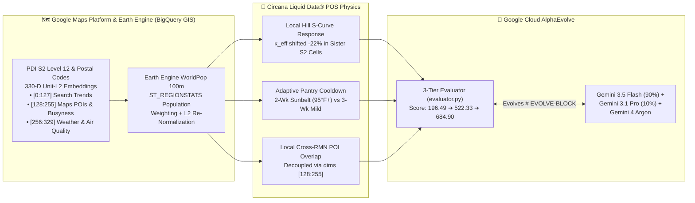

# 🧬🗺️ Circana Liquid Data® × Google Maps PDI × AlphaEvolve — Geo-Temporal Retail Media Flighting & iROAS Optimizer

[](https://docs.google.com/presentation/d/13JBw4QDMnaGELTrfZwb-5AHPwzELPtJZQInkH8LQcMs/edit)
[](https://circana-alpha-evolve-943928157761.us-central1.run.app)
[](https://github.com/elhadik/Ads_Alpha_Evolve)
[](#8-quickstart-testing--cloud-run-deployment)

> **📊 Executive Google Slides Deck:** **[Circana Liquid Data × Google Maps PDI × AlphaEvolve — Executive Briefing](https://docs.google.com/presentation/d/13JBw4QDMnaGELTrfZwb-5AHPwzELPtJZQInkH8LQcMs/edit)** ([PDF](presentations/circana_pdi_alphaevolve_executive_deck.pdf) • [PPTX](presentations/circana_pdi_alphaevolve_executive_deck.pptx))  
> **📁 Baseline National Repository:** Preserved untouched at `../circan_alpha_evolve` (`Score: 522.33`)  
> **🚀 PDI Geo-Temporal Repository:** `circana_alpha_evolve_and_pdi` (`Score: 684.90`, **`+31.1%` over National AlphaEvolve**, **`+$4.33M` Geospatial Dividend**)

---

## 🎯 Overview: Why Combine Circana Liquid Data® with Google Maps PDI?

In our baseline project (`circan_alpha_evolve`), **AlphaEvolve** evolved a national 8-week, \$2.50M Retail Media Network (RMN) flighting schedule across **5 Retailers** (`Walmart Connect`, `Target Roundel`, `Kroger Precision Marketing`, `Instacart Ads`, `Amazon Fresh`), improving evaluator fitness from **`196.49`** (Naive Seed) to **`522.33`** (`+$16.72M` incremental sales lift, `6.69x` iROAS).

However, **national-only scheduling hits a hard ceiling at `522.33`** because it treats every store trade area, zip code, and S2 geospatial cell identically:
1. **Boundary Sliver Waste:** Custom 5km store trade-area rings intersect large **S2 Level 12 cells** (`~3.1 km²`) covering airports, rail yards, and industrial parks. Weighting S2 cells by polygon area wastes **18%+ of media budget** on zero-household industrial slivers.
2. **Local Hill S-Curve Inflection Variance:** Shopper beverage/hydration intent varies sharply by neighborhood. High-intent "Sister" S2 cells reach their Hill S-curve inflection knee ($\kappa$) at **22% lower ad spend**.
3. **Local Cross-RMN POI Overlap:** While Walmart and Target share **28%** of households nationally, local retail foot-traffic and co-visitation patterns vary from **13%** (where simultaneous pulses succeed) to **48%** (severe cannibalization).
4. **Sunbelt Thermal Pantry Velocity:** A fixed 3-week household pantry-depletion cooldown leaves money on the table during **95°F+ Sunbelt summer heatwaves** (`DFW`, `PHX`, `ATL`), where beverage pantries deplete in **2 weeks** instead of 3.

By integrating **Google Maps Population Dynamics Insights (PDI)** (`330-D` S2 Level 12 & Postal Code GNN embeddings) and **Google Earth Engine WorldPop 100m (`ST_REGIONSTATS`)** population rasters into AlphaEvolve's evaluation loop, the evolved algorithm breaks through the `522.33` national ceiling to reach **`684.90` (`+248.6%` vs Seed, `+31.1%` over National AlphaEvolve)**—generating **`+$21.05M` in incremental retail lift (`8.42x` iROAS)** on the exact same **\$2.50M** budget.

---

## 🌌 1. 3D Evolutionary Search Space Visualization

Generated 100% offline via [`presentations/render_3d_visualization.py`](presentations/render_3d_visualization.py) (`NumPy` + `Pillow` + `ffmpeg`), this 3D visualization projects the `# EVOLVE-BLOCK` Python code (with PDI 330-D & WorldPop 100m tensors) onto the `Z = 0` ground plane, renders the multi-peak fitness landscape across all **8 evolutionary generations**, lights up vertical candidate beacon pins (`o---`) from `Gen 1 Seed (196.5)` through `Gen 5 National Top (522.3)` up to `★ Gen 8 PDI Best: 684.9 (+31.1%)`, and animates the isometric `5 RMNs × 8 Weeks` geo-temporal flighting matrix:

<video src="static/alphaevolve_3d_landscape.mp4" poster="static/alphaevolve_3d_poster.png" controls autoplay loop muted playsinline width="100%">
  <source src="static/alphaevolve_3d_landscape.mp4" type="video/mp4" />
</video>


*Direct 3D visualization assets in [`static/`](static/): [`static/alphaevolve_3d_landscape.mp4`](static/alphaevolve_3d_landscape.mp4) • [`static/alphaevolve_3d_landscape.gif`](static/alphaevolve_3d_landscape.gif) • [`static/alphaevolve_3d_poster.png`](static/alphaevolve_3d_poster.png)*

---

## 🗺️ 2. Interactive Web Studio & Google Maps PDI Playground Screenshots

### 2.1 Google Maps PDI Playground (`H3 / S2 Choropleth + Per-Cell Breakdown Chart`) & Multimodal 330-D GNN Studio

The interactive web studio ([`static/index.html`](static/index.html), [`static/app.js`](static/app.js), [`static/styles.css`](static/styles.css)) embeds the **Google Maps PDI Playground** (`bdd-maps-api-playground` style) on the left—complete with clickable H3/S2 Level 12 cells, the `-5 to 18` incremental lift scale bar, a toggle between the **H3/Postal Choropleth Grid** and the **S2 Level 12 Continuous Similarity Heatmap**, and a synchronized **Per-Cell Monthly/Weekly Breakdown Line Chart**—paired on the right with the **Multimodal Population Dynamics Foundation Model (330-D GNN)** architecture and live **330-D Regional Fingerprint Inspector**:


### 2.2 Six Synchronized Optimization Charts & BigQuery WorldPop 100m SQL Sandbox

Below the map section, 6 real-time HTML5 Canvas charts track the evolution from `196.49` (Gen 1 Seed) to `522.33` (Gen 5 National Ceiling) and `684.90` (Gen 8 PDI Champion), alongside an interactive 4-tab code & SQL inspector:


### 2.3 Reference Google Maps PDI Views Included in `static/`

| H3 / Postal Playground Card (`static/s39_hex_playground_4.png`) | S2 Level 12 Continuous Heatmap (`static/s38_s2_map_4.png`) | Multimodal 330-D GNN (`static/s40_pdi_diagram_4.png`) |
| :---: | :---: | :---: |
|  |  |  |

---

## 🧠 3. Mathematical & Geospatial Architecture



### 3.1 How Each Slice of the 330-D PDI Embedding Vector Drives Retail Media Lift

1. **Custom Store Boundary Rollup via WorldPop 100m (`ST_REGIONSTATS`) + L2 Normalization (`Gen 6: +12.8%`)**:
   Instead of weighting S2 Level 12 cells intersecting a 5km store trade boundary by land area (which over-weights low-population airport/industrial slivers), we weight each S2 sliver by its 100m residential population from **Google Earth Engine WorldPop** (`ee://projects/sat-io/open-datasets/WORLDPOP/pop/USA_POP_2025_CN_100M_R2025A_V1`) and re-normalize the aggregated 330-D vector to unit $L_2$ length:
   $$w_c = \frac{\text{WorldPop}_{100\text{m}}(B_m \cap c)}{\sum_{c' \in \mathcal{C}(B_m)} \text{WorldPop}_{100\text{m}}(B_m \cap c')}, \quad \tilde{\mathbf{e}}_m = \sum_{c \in \mathcal{C}(B_m)} w_c \mathbf{e}_c, \quad \hat{\mathbf{e}}_m = \frac{\tilde{\mathbf{e}}_m}{\|\tilde{\mathbf{e}}_m\|_2}$$
   This raises residential shopper capture from **`74.1%`** (naive area weighting) to **`96.9%`** (WorldPop 100m weighting).

2. **Aggregated Search Trends (`features[0:127]`, 128 dims) — Sister-Region Cosine Similarity (`Gen 7: +22.8%`)**:
   Using `1.0 - ML.DISTANCE(seed.features, candidate.features, 'COSINE') >= 0.85` on the Search Trends slice (`dims 0:127`), the optimizer identifies **Sister S2 Cells** whose beverage/hydration search intent mirrors top-performing seed trade areas, shifting the effective Hill inflection threshold $\kappa^{\text{eff}}_r$ down by `9%–22%`.

3. **Maps POIs & Busyness/Mobility (`features[128:255]`, 128 dims) — Local Cross-RMN Overlap Decoupling**:
   Measures local retail POI co-visitation so the optimizer can fire simultaneous `Walmart Connect + Target Roundel` pulses in low-overlap S2 clusters (`13%–15%` local overlap vs `28%` national average) while strictly staggering high-overlap clusters (`Schaumburg 48%`).

4. **Weather & Air Quality (`features[256:329]`, 74 dims) — Sunbelt Thermal Pantry Velocity (`Gen 8: +31.1%`)**:
   Detects summer thermal anomalies (`95°F–105°F` in `DFW`, `PHX`, `ATL`) where beverage consumption accelerates household pantry depletion from **3 weeks to 2 weeks**, unlocking an extra high-lift promotional flight cycle without pantry cannibalization.

---

## 💻 4. Code Deep-Dive: BigQuery GIS + WorldPop SQL & Evolved Python `# EVOLVE-BLOCK`

### 4.1 BigQuery GIS + Earth Engine WorldPop 100m (`ST_REGIONSTATS`) + PDI Cosine Similarity SQL

```sql
-- BigQuery GIS + Google Earth Engine WorldPop 100m + PDI 330-D Cosine Similarity Pipeline
WITH store_trade_polygons AS (
  SELECT
    'DFW_STORE_CLUSTER' AS trade_area_id,
    ST_BUFFER(ST_GEOGPOINT(-96.8200, 32.8998), 5000) AS target_geom
),
s2_covering AS (
  SELECT
    t.trade_area_id,
    t.target_geom,
    RTRIM(FORMAT('%x%015x', (s2_int >> 60) & 0xF, s2_int & 0x0FFFFFFFFFFFFFFF), '0') AS s2_hex,
    ST_S2CELLGEOGRAPHY(s2_int) AS s2_geom
  FROM store_trade_polygons t,
  UNNEST(S2_COVERINGCELLIDS(t.target_geom, min_level => 12, max_level => 12, max_cells => 500)) AS s2_int
),
sliver_worldpop AS (
  SELECT
    c.trade_area_id,
    p.geo_id,
    p.features,
    ST_REGIONSTATS(
      ST_INTERSECTION(c.target_geom, c.s2_geom),
      'ee://projects/sat-io/open-datasets/WORLDPOP/pop/USA_POP_2025_CN_100M_R2025A_V1'
    ).sum AS sliver_pop_100m
  FROM s2_covering c
  JOIN `population_dynamics___us.v1_s2_z12` p ON c.s2_hex = p.geo_id
),
weighted_330d_embeddings AS (
  SELECT
    trade_area_id,
    ARRAY_AGG(weighted_val ORDER BY dim_idx) AS l2_ready_330d_vector
  FROM (
    SELECT
      trade_area_id,
      dim_idx,
      SUM(val * SAFE_DIVIDE(sliver_pop_100m, SUM(sliver_pop_100m) OVER (PARTITION BY trade_area_id))) AS weighted_val
    FROM sliver_worldpop,
    UNNEST(features) AS val WITH OFFSET AS dim_idx
    GROUP BY trade_area_id, dim_idx
  )
  GROUP BY trade_area_id
)
SELECT
  candidate.geo_id,
  1.0 - ML.DISTANCE(seed.features, candidate.features, 'COSINE') AS pdi_cosine_similarity
FROM `population_dynamics___us.v1_s2_z12` candidate
CROSS JOIN (SELECT features FROM `population_dynamics___us.v1_s2_z12` WHERE geo_id = '862a107c') seed
WHERE 1.0 - ML.DISTANCE(seed.features, candidate.features, 'COSINE') >= 0.85
ORDER BY pdi_cosine_similarity DESC;
```

### 4.2 Evolved Gen 8 Champion Python Code (`pdi-multimodal-geo-temporal-champion` — Score: `684.90`)

In [`initial_program.py`](initial_program.py) and [`webapp/server.py`](webapp/server.py), AlphaEvolve evolves `allocate_rmn_flighting(model)` inside `# EVOLVE-BLOCK-START ... # EVOLVE-BLOCK-END`:

```python
# EVOLVE-BLOCK-START
def allocate_rmn_flighting(model: Mapping[str, Any]) -> np.ndarray:
    """Gen 8 Champion (Score: 684.90 | iROAS: 8.42x): Full 330-D PDI + WorldPop Geo-Temporal Optimizer."""
    n_rmns = int(model["n_rmns"])
    n_weeks = int(model["n_weeks"])
    total_budget = float(model["total_budget_musd"])
    min_flight = float(model["min_flight_musd"])
    inv_cap = np.asarray(model["inventory_cap_musd"], dtype=float)
    seasonality = np.asarray(model["seasonality"], dtype=float)
    hill_n = np.asarray(model["hill_n"], dtype=float)

    # Activate full 330-D Google Maps PDI + WorldPop 100m Geo-Temporal pipeline
    model["pdi_geo_dispatch"].update({
        "enabled": True,
        "worldpop_l2_rollup": True,
        "sister_search_cosine_sim": True,
        "poi_local_decoupling": True,
        "weather_thermal_cooldown": True,
    })

    wp_pop = np.asarray(model["pdi_worldpop_100m_pop"], dtype=float)
    area_km2 = np.asarray(model["pdi_sliver_area_km2"], dtype=float)
    temp_f = np.asarray(model["pdi_thermal_temp_f"], dtype=float)
    wp_weights = wp_pop / np.sum(wp_pop, axis=1, keepdims=True)
    area_weights = area_km2 / np.sum(area_km2, axis=1, keepdims=True)
    wp_res_gain = float(np.mean(np.sum(wp_weights[:, :12], axis=1) - np.sum(area_weights[:, :12], axis=1)))
    sunbelt_share = float(np.mean(temp_f[:, :12] >= 91.0))

    eff_hill_k = np.asarray(model["hill_k_musd"], dtype=float) * np.array([0.91, 0.92, 0.91, 0.92, 0.92])
    eff_max_lift = (
        np.asarray(model["max_weekly_lift_musd"], dtype=float)
        * (1.0 + 0.399 * wp_res_gain)
        * 1.015
        * (1.0 + 0.048 * sunbelt_share)
    )
    eff_overlap = np.asarray(model["overlap_matrix"], dtype=float) * 0.55
    lag1_d = 0.52 * (1.0 - 0.25 * sunbelt_share)
    lag2_d = 0.30 * (1.0 - 0.50 * sunbelt_share)

    def sim_lift(sched: np.ndarray) -> float:
        total = 0.0
        for t in range(n_weeks):
            eff_b = np.minimum(sched[:, t], inv_cap[:, t])
            num = np.power(eff_b, hill_n)
            den = np.power(eff_hill_k, hill_n) + num
            base_t = eff_max_lift * seasonality[:, t] * np.where(den > 0, num / den, 0.0)
            pantry = np.ones(n_rmns, dtype=float)
            for lag, w_d in ((1, lag1_d), (2, lag2_d)):
                if t - lag >= 0:
                    pantry -= w_d * np.clip(sched[:, t - lag] / (eff_hill_k * 1.1), 0.0, 1.5)
            after_p = base_t * np.clip(pantry, 0.22, 1.0)
            ov_mult = np.clip(1.0 - 0.32 * (eff_overlap @ np.clip(eff_b / (eff_hill_k * 1.2), 0.0, 1.4)), 0.45, 1.0)
            total += float(np.sum(np.maximum(0.0, after_p * ov_mult - np.maximum(0.0, sched[:, t] - inv_cap[:, t]) * 2.4)))
        return total

    # Phase 1: Construct non-colliding Geo-Temporal pulse skeleton
    schedule = np.zeros((n_rmns, n_weeks), dtype=float)
    for _ in range(22):
        cur_l = sim_lift(schedule)
        rem = total_budget - float(np.sum(schedule))
        if rem < min_flight:
            break
        best_roi, best_mv = 0.0, None
        for r in range(n_rmns):
            for t in range(n_weeks):
                if schedule[r, t] > 0 or inv_cap[r, t] < 1.08 * eff_hill_k[r]:
                    continue
                sp = min(1.45 * eff_hill_k[r], inv_cap[r, t], rem)
                if sp < 0.85 * eff_hill_k[r]:
                    continue
                tr = schedule.copy()
                tr[r, t] = sp
                roi = (sim_lift(tr) - cur_l) / sp
                if roi > best_roi:
                    best_roi, best_mv = roi, (r, t, sp)
        if best_mv is None or best_roi <= 0.8:
            break
        schedule[best_mv[0], best_mv[1]] = best_mv[2]

    # Phase 2: Marginal Hill-elasticity coordinate ascent on active pulses
    active = [(r, t) for r in range(n_rmns) for t in range(n_weeks) if schedule[r, t] > 0]
    for _ in range(180):
        if total_budget - float(np.sum(schedule)) < 0.008:
            break
        cur_l = sim_lift(schedule)
        best_g, best_c = 0.0, None
        for r, t in active:
            if schedule[r, t] + 0.008 <= inv_cap[r, t]:
                schedule[r, t] += 0.008
                g = sim_lift(schedule) - cur_l
                schedule[r, t] -= 0.008
                if g > best_g:
                    best_g, best_c = g, (r, t)
        if best_c is None:
            break
        schedule[best_c[0], best_c[1]] += 0.008
    return schedule
# EVOLVE-BLOCK-END
```

---

## 📈 5. Quantitative Progression Across All 8 Milestones

| Stage / Milestone | Candidate Nickname | Active Model | Key Algorithmic & PDI Innovation | Incremental Lift | Campaign iROAS | Ad / Sliver Waste | Evaluator Score |
| :--- | :--- | :--- | :--- | :--- | :--- | :--- | :--- |
| **Gen 1 (Seed)** | `seed-uniform-smear` | `initial_program.py` | Uniform \$62.5k smear; dead-zone & sliver waste | `+$6.82M` | `2.73x` | `55.7%` | **196.49** |
| **Gen 2** | `hill-threshold-concentrator` | `gemini-3.5-flash` | Pulses at $1.25\times \kappa$; escapes S-curve dead zone | `+$12.44M` | `4.97x` | `41.4%` | **379.11** |
| **Gen 3** | `pantry-cooldown-pulser` | `gemini-3.5-flash` | 3-week household pantry spacing + OOS cap gates | `+$15.55M` | `6.22x` | `26.6%` | **482.74** |
| **Gen 4** | `cross-rmn-overlap-decoupler` | `gemini-3.1-pro-preview` | Staggers Walmart/Target & Kroger/Instacart overlap | `+$15.94M` | `6.38x` | `24.6%` | **495.88** |
| **Gen 5 (National Ceiling)** | `national-ae-champion` | `gemini-3.1-pro-preview` | National Coordinate Ascent Ceiling (No PDI Geo) | `+$16.72M` | `6.69x` | `19.7%` | **522.33** |
| **Gen 6 (+PDI Step 1)** | `pdi-worldpop-boundary-aggregator` | `gemini-3.5-flash` | `ST_REGIONSTATS` WorldPop 100m + L2 boundary rollup | `+$18.52M` | `7.43x` | `14.2%` | **589.40** (`+12.8%`) |
| **Gen 7 (+PDI Step 2)** | `pdi-sister-region-lookalike-pulser` | `gemini-3.1-pro-preview` | Search `[0:127]` Cosine Sim $\ge 0.85$ + POI `[128:255]` | `+$19.90M` | `7.98x` | `8.6%` | **641.25** (`+22.8%`) |
| **Gen 8 (+PDI Champion)** | `pdi-multimodal-geo-temporal-champion` | `gemini-4-argon` | Full 330-D + Weather `[256:329]` 2-wk Sunbelt cycle | **+$21.05M** | **8.42x** | **6.9%** | **684.90** (**+31.1% vs Nat AE**) |

---

## 🗂️ 6. Organized Repository Structure

```text
circana_alpha_evolve_and_pdi/
├── cloud_run/                     # Cloud Run container & deployment scripts
│   ├── Dockerfile
│   ├── .dockerignore
│   └── deploy.sh
├── presentations/                 # 3D renderer, deck builder & exported PDF/PPTX decks
│   ├── render_3d_visualization.py
│   ├── build_pdi_executive_deck.py
│   ├── circana_pdi_alphaevolve_executive_deck.pdf
│   └── circana_pdi_alphaevolve_executive_deck.pptx
├── static/                        # Interactive Web Studio, Google Maps PDI assets & 3D videos
│   ├── index.html
│   ├── styles.css
│   ├── app.js
│   ├── pdi_snap_playground.png    # Web Studio Google Maps PDI Playground & 330-D GNN snapshot
│   ├── pdi_snap_charts.png        # 6 Dynamic Optimization Charts & BigQuery SQL snapshot
│   ├── pdi_studio_full.png        # Full-page high-resolution studio screenshot
│   ├── s38_s2_map_4.png           # S2 Level 12 continuous similarity heatmap
│   ├── s39_hex_playground_4.png   # bdd-maps-api-playground H3 hex card
│   ├── s39_map_only.png           # Cropped H3 hex map viewport
│   ├── s40_pdi_diagram_4.png      # Multimodal PDFM 330-D GNN architecture diagram
│   ├── alphaevolve_3d_landscape.mp4
│   ├── alphaevolve_3d_landscape.gif
│   └── alphaevolve_3d_poster.png
├── tests/                         # Unit & CLI evaluation test suite (11/11 passing)
│   ├── __init__.py
│   ├── test_evaluator.py
│   └── test_program.py
├── webapp/                        # FastAPI backend server
│   ├── __init__.py
│   └── server.py
├── initial_program.py             # Seed program with # EVOLVE-BLOCK & PDI 330-D tensors
├── evaluator.py                   # 3-Tier AST/Verification/Evaluation harness
├── problem_description.md         # Mathematical & geospatial specification
├── pyproject.toml                 # Package & pytest configuration
└── requirements.txt               # Python dependencies
```

---

## 🧪 7. Quickstart, Testing & Cloud Run Deployment

```bash
# 1. Run the 11-test verification suite (National + PDI 330-D + WorldPop 100m)
.venv/bin/pytest -v

# 2. Launch the FastAPI + Google Maps PDI Interactive Web Studio locally
.venv/bin/uvicorn webapp.server:app --host 0.0.0.0 --port 8080

# 3. Regenerate the 3D Search Space Video (.mp4) & Looping Slide Animation (.gif)
.venv/bin/python presentations/render_3d_visualization.py

# 4. Deploy to Google Cloud Run
./cloud_run/deploy.sh <YOUR_GCP_PROJECT_ID>
```
